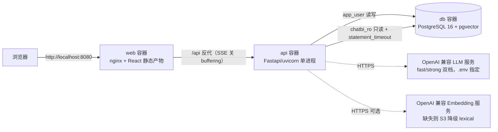

# SDD · 后端技术方案

> 版本：v0.2（P4 产出，按算法 SDD v0.4 对齐重写，待评审）
>
> **相对 v0.1 的关键变化（随算法范式重构）**：
> - 链路由旧 S1～S10 改为算法文档的固定 8 步（S1 理解 → S2 模板快路径 → S3 检索 → S4 对齐 → S5 生成 SQL → S6 执行 → S7 出表图 → S8 解读）；
> - **SQL 改由算法 Coder（LLM）生成并经算法 lint 自环校验，后端不再自建 SQL builder/guard**；后端 QueryRunner 只保留只读角色、超时、限幅三道执行层兜底；
> - 一次问数的唯一返回契约是算法的 `ChainResult`（§6）：本文件所有 DTO/SSE 报文均镜像它——`narrative` 改名 `insight`，图型去 `dual_line`、增 `trend_line`，`chart` 可为 `null`，对比载荷带 `changes[]`；空结果是 `answer`（rows 为空）不是独立状态；
> - 查询生成失败/执行失败从系统错误改为 `ChainResult` 的 rejection 类终态（`GEN_LINT_EXHAUSTED` / `QUERY_TIMEOUT` / `QUERY_ERROR`）；SSE `error` 事件只承载 `action=error`（LLM/内部故障）；
> - 字典从硬闸门降为可选增强：L0 库结构启动自动抽取（必需、总有），L1 字典/模板/示例为可选增强；可答边界＝已接入数据库；
> - 新增示例库：`exemplar` 表 + pgvector，Embedding 缺失自动降级 lexical；**本地与生产统一走 Supabase 托管（2026-10-17 改）**，经连接配置与 Repository 接口切换（算法 §7.3、本文 §7.4）；Compose 三容器保留为可选部署交付物、本版不验收。
>
> **算法链路（8 步、IntentSpec/QuerySpec/ComparisonSpec、ChainResult、澄清/拒答判定、lint 规则）以 [SDD-算法应用.md](./SDD-算法应用.md) 为准**；本文件只写：服务怎么拆、如何调用 `run_chain` 与注入依赖、接口契约、怎么落库、在哪里查数执行、怎么部署。
> 前端如何消费这些接口看 [SDD-前端.md](./SDD-前端.md)；全局对照与衔接时序看 [SDD-总览.md](./SDD-总览.md)。

---

## 1. 技术决策（写死一版）

| 决策点 | 结论 | 理由 |
|---|---|---|
| 语言/框架 | **Python 3.12 + FastAPI + uvicorn**，pydantic v2 做契约 | LLM/LangGraph 生态在 Python；FastAPI 原生 async 适合 SSE 过程推送，OpenAPI 自带契约文档 |
| 服务形态 | **单后端服务 `api`，内部模块化**；不拆微服务、不上消息队列 | 本版规模一个进程足够；模块边界（见第 2 节）保证以后能拆，容器编排拆服务属于过度设计（PRD Out） |
| 编排 | LangGraph 以**进程内函数调用**嵌入：application 层调 `run_chain` 并**注入全部外部依赖**（QueryRunner / LLM / Embedding / Repository / 资源路径） | 链路见算法文档；算法不直连库、不感知存储行模型；省一跳网络，状态不用跨服务序列化 |
| 数据库 | **PostgreSQL 16（镜像 `pgvector/pgvector:pg16`）单实例，双 schema 双角色**（见 §5.1） | 一套库同时承载模拟数仓、应用数据与 exemplar 向量；pgvector 同库部署，零新组件；窗口/CTE 支撑档期对比；只读角色是安全底线 |
| ORM/驱动 | SQLAlchemy 2（仅应用库 app schema）+ psycopg3；数仓查询走裸连接 | 应用数据需要 ORM；查数链路必须完全受控，不经过 ORM 改写 |
| SQL 生成/校验 | **归属算法层**：Coder（LLM）生成 SQL，算法 lint（表白名单按 L0、禁写语句、列归属、LIMIT 注入，sqlglot 作为算法 lint 的解析依赖）自环 ≤2 轮 | 语义对齐与 SQL 生成分属 Aligner/Coder；后端不做编译改写，避免新旧两套 SQL 逻辑 |
| 执行兜底 | 后端 QueryRunner：单条只读 SELECT（含 UNION/UNION ALL 组合，对齐 SDD-算法应用 §S5 对比 SQL）+ `statement_timeout=10s` + 行数限幅 | lint 是第一道，账号/超时/限幅是执行层最后兜底；权限与资源边界必须在后端 |
| 部署 | Docker Compose 三服务：db / api / web | 对齐 PRD F9 |
| 进程模型 | uvicorn **单 worker**；turn 注册表、事件缓冲、LangGraph checkpointer 本版放进程内存 | 单 worker 即可演示；多 worker/外部 broker 本版明确不做（非目标）；澄清卡状态另以 messages 落库为准 |

---

## 2. 服务职责边界与模块划分

后端只有一个部署单元，内部按职责分五层。**层间依赖只能向下**：

```text
api 服务（FastAPI）
├─ api 层        HTTP 路由 + pydantic 报文（镜像 ChainResult）+ 错误码翻译；不含业务判断
│  └─ routes/: chat.py / sessions.py / reports.py / health.py
├─ application 层   用例编排（事务边界在这里）
│  ├─ conversation_service.py   建 turn、组装 run_chain 入参与依赖注入、
│  │                            节点回调翻译为 SSE stage、消息落库与事件缓冲
│  └─ report_service.py         存报表/改名/删除/打开/刷新/继承会话
├─ algorithm 层   智能链路（目录树与职责以算法文档 §5 为唯一权威，后端只调用不重写）
│  └─ graph.run_chain / state.ChainResult / agents / nodes / retrieval / llm / resources
├─ data 层
│  ├─ engines.py        双引擎（app 读写 / analytics 只读裸连接）
│  └─ query_runner.py   实现算法要求的 QueryRunner 协议：单条只读 SELECT（含 UNION 组合）、
│                       statement_timeout=10s、行数限幅并回传 truncated
└─ storage 层    SQLAlchemy 模型与仓储，只管 app schema
   └─ models.py / repositories.py   # sessions / messages / reports / exemplar / meta_schema_cache
```

职责硬边界：

1. **api 层不直接调 `run_chain`**：问数必须经 `conversation_service`，由它负责依赖注入、落库与事件分发；
2. **report_service 不重走理解/对齐**：打开报表只读快照；刷新复用存储的 `QuerySpec` **从算法 S5 进入**（gen_sql → lint → execute → build_view → insight），不经过 S1～S4；
3. **algorithm 层不 import storage、不持有数据库连接串**：查数只经后端注入的 `QueryRunner`；exemplar/缓存读写走算法 §7 的 `Repository` 接口（本版由 storage/data 层实现为 psycopg + pgvector，连接串即指向 Supabase；换托管只换该实现与连接配置）；
4. **所有写操作只走 app 引擎**；analytics 引擎在代码层面即使用只读连接串；
5. **后端不生成、不改写业务 SQL**：SQL 好坏由算法 S5 的 lint 拦（回炉 Coder）；QueryRunner 收到什么执行什么，但用只读账号、超时、限幅兜底，且只允许单条只读 SELECT（含 UNION/UNION ALL 组合的只读 SELECT，对齐 SDD-算法应用 §S5）。

application 层调用算法的契约（示意，字段名以算法 `state.py` 为准）：

```python
result: ChainResult = await run_chain(
    entry=ChainEntry(
        question="...",                    # ① 新问题
        # clarified_question="...",        # ② 澄清确认重入：后端把用户选择拼好的确认后问法，
        #                                  #    从 S1 重入，checkpointer 恢复槽位
        # recalibrate_spec=query_spec,     # ③ 口径不对重新澄清：带原 turn 的 QuerySpec 从 S4 进入，
        #                                  #    强制就原指标/维度/时间/筛选项产出 clarify 卡
        session_caliber_summary="...",     # 多轮承接：最近 N 轮口径摘要（本版 N=5）
        checkpoint=...,                    # 澄清重入用；本版进程内 checkpointer
    ),
    deps=ChainDeps(
        llm=llm_client,                    # OpenAI 兼容，fast/strong 双档（算法 §8）
        embedding=embedding_client,        # 未配置则传 None，S3 自动 mode=lexical
        query_runner=query_runner,         # 后端实现并注入；算法不直连库
        repo=repository,                   # exemplar / schema cache 的 Repository 实现
        resources_path="/app/algorithm/resources",  # L1 字典 + 模板 YAML；文件可缺省
    ),
    on_node=on_node_callback,              # 节点回调 → SSE stage（映射见 §3.2）
)
```

---

## 3. 接口契约

### 3.1 通用约定

- Base path：`/api/v1`；请求/响应均为 `application/json`（SSE 除外）；
- 时间：ISO-8601 字符串；id：UUID 字符串；
- 本版无登录，所有资源隐式属于单用户 `default`（见 [SDD-前端.md](./SDD-前端.md) 第 7 节与总览非目标）；
- 错误信封：

```json
{ "error": { "code": "E_VALIDATION", "message": "问题不能为空", "retryable": false } }
```

- 问数类故障分两层：**建 turn 的同步错误**走 HTTP 状态码 + 错误信封；**链路执行中的终态**随 SSE 推送（HTTP 建流本身是 200）——其中 `error` 事件只对应 `ChainResult.action=error`（LLM/内部故障），生成失败/查询失败是 `rejection` 事件而非系统错误；
- 错误码总表见第 8 节。

### 3.2 问数与澄清（F1/F2/F3/F4）

#### POST `/chat/turns` — 发起一轮问数（新问题 / 澄清确认 / 重新澄清 三选一）

请求体：

```jsonc
// ① 新问题
{ "session_id": "可选，不带则新建会话", "question": "618 大促期间各渠道 GMV，按从高到低排" }

// ② 澄清确认
{ "session_id": "uuid", "clarify": {
    "clarify_id": "uuid",
    "selection": { "type": "option", "value": "beauty_personal_care" }
}}
// selection.type: option（单选）| time_preset（快捷时间，值为预设 key 或 {start,end}）| custom（我换个问法，value 为新问题文本）
// 后端把选择拼成 clarified_question，以算法 S1 重入（checkpointer 恢复槽位）

// ③ 结果卡片「口径不对，重新澄清」（PRD 4.1）
{ "session_id": "uuid", "recalibrate": { "source_turn_id": "uuid" }}
// 后端取 source turn 已落库的 QuerySpec，以 recalibrate_spec 调 run_chain：
// 算法从 S4 进入并强制产出 clarify 卡（对原指标/维度/时间/筛选项逐项给重选入口），不执行 SQL；
// 原结果卡片作为历史保留；原 turn 不存在 → 404 E_NOT_FOUND。
```

- 三种入参互斥，恰好传一种；

响应 `202`：

```json
{ "turn_id": "uuid", "session_id": "uuid", "status": "running" }
```

同步失败：`400 E_VALIDATION`（空问题/超长/入参不互斥）、`409 E_CLARIFY_EXPIRED`（clarify 票据不存在/已确认/已取消）。

#### GET `/chat/turns/{turn_id}/events` — SSE 事件流

`Content-Type: text/event-stream`。事件顺序：零或多个 `stage` → **恰好一个终态事件** → `done`。

**过程事件 → 算法节点映射（写死，同阶段去重）**：

| 算法节点（on_node 回调） | SSE `stage` | 前端文案 |
|---|---|---|
| S1 understand | `understanding` | 正在理解问题 |
| S2 template_match / S3 retrieve / S4 align | `checking_caliber` | 正在核对口径 |
| S5 gen_sql / S6 execute / S7 build_view / S8 insight | `querying` | 正在取数 |

**终态事件 → ChainResult.action 映射（恰好一个）**：

| ChainResult | 说明 | SSE 终态事件 |
|---|---|---|
| `action=answer` | 含空结果（rows=[]、chart=null） | `answer` |
| `action=clarify` | 澄清卡，本轮不执行任何查询 | `clarification` |
| `action=not_answerable` | reason_code：`NOT_DATA_QUESTION` / `NO_MATCHING_DATA` / `CALIBER_CONFLICT` | `rejection` |
| `action=query_gen_failed` | reason_code：`GEN_LINT_EXHAUSTED`（带 lint 原因） | `rejection` |
| `action=query_failed` | reason_code：`QUERY_TIMEOUT` / `QUERY_ERROR`（前端给「重试」） | `rejection` |
| `action=error` | `{code,message,retryable}`，如 `E_LLM_UNAVAILABLE` | `error` |
| 用户取消 | 取消在节点间与 S6 执行期生效（算法 §3） | `cancelled` |

事件帧一览：

| event | data 载荷 | 说明 |
|---|---|---|
| `stage` | `{ "stage": "understanding"\|"checking_caliber"\|"querying", "label": "正在理解问题" }` | 三行过程状态 |
| `answer` | AnswerEvent（见下，镜像 `ChainResult.answer`） | 数据卡片；空结果是同构 answer，不是错误 |
| `clarification` | ClarificationPayload（见下） | **澄清终态：本轮不执行任何查询** |
| `rejection` | RejectionPayload（见下） | **拒答/失败终态：无任何数字**；QUERY_TIMEOUT/QUERY_ERROR 可重试 |
| `error` | `{code,message,retryable}` | 仅 LLM/内部故障终态 |
| `cancelled` | `{ "turn_id": "uuid" }` | 用户取消终态 |
| `done` | `{ "turn_id": "uuid" }` | 恒为最后一帧，前端据此关闭流 |

建流失败：`404 E_TURN_NOT_FOUND`。断线重连：服务端在内存保留该 turn 事件缓冲 10 分钟，按 `Last-Event-ID` 尽力补帧；超时则前端引导用户在消息流里重试提问。

**AnswerEvent**（前端结果卡片与报表快照共用这一份结构；`table/chart/insight/caliber/comparison` 五个字段逐字镜像算法 §6 的 `ChainResult.answer`，后端只加信封字段）：

```jsonc
{
  "turn_id": "uuid", "session_id": "uuid", "question": "原始问题",

  "table": {
    "columns": [{ "field": "channel", "label": "渠道", "format": "text" },
                { "field": "gmv", "label": "GMV（元）", "format": "number:2" }],
    "rows": [{ "channel": "渠道 A", "gmv": 120345678.9 }],
    "truncated": false,
    "display_limit": 500
  },
  "chart": {
    "type": "bar",                  // bar | line | trend_line | grouped_bar | pie；无图为 null
    "x_field": "channel",
    "series": [{ "field": "gmv", "label": "GMV（元）" }],
    "switchable": ["bar", "line"]  // 允许前端本地切换的图型
  },
  "insight": "渠道 A 的 GMV 最高，为 1.2 亿，占全渠道约 42%。",
  "caliber": {
    "summary": "GMV ｜ 按渠道 ｜ 2026-06-01 至 2026-06-20 ｜ 无额外筛选",
    "detail": {
      "metrics": [{ "id": "gmv", "name": "GMV" }],
      "dimensions": [{ "id": "channel", "name": "渠道" }],
      "time_range": { "start": "2026-06-01", "end": "2026-06-20", "label": "618 大促期" },
      "filters": [],
      "comparison": null
    }
  },
  "comparison": null,
  // 非对比时为 null；对比时（算法 §4）：
  // { "mode": "yoy"|"mom"|"custom",
  //   "periods": [{ "key": "A", "label": "去年同期", "start": "...", "end": "..." }],
  //   "changes": [{ "key": "渠道 A", "value_delta": 12345.6, "rate_delta": 18.3 }] }
  // rate_delta=null 表示分母为 0「不可比」，前端原样呈现；变化值/率由算法代码 Decimal 计算

  "data_time_range": { "start": "2025-06-01", "end": "2026-06-30" },  // 后端信封：从 QuerySpec.time_range 派生
  "queried_at": "2026-10-17T10:00:00Z",
  "saveable": true                  // 后端派生：= answer 且 table.rows 非空
}
```

**空结果约定**：同一个 `answer` 事件，`table.rows=[]`、`chart=null`、`insight` 为「该范围无数据」语义句（算法 S8 固定产出）、`caliber` 照给、`saveable=false`；没有独立的 empty 状态码，也不出 suggestions。

**ClarificationPayload**（逐字镜像算法 §6 `ChainResult.clarify`，另加落库态 `status`）：

```jsonc
{
  "clarify_id": "uuid", "round": 1,            // 两轮上限：round ∈ {1,2}
  "title": "请确认类目口径",
  "reason_code": "METRIC_DIM_AMBIGUOUS",       // METRIC_DIM_AMBIGUOUS | MISSING_TIME
                                               // | VAGUE | ANAPHORA_UNRESOLVED
  "input_type": "single_choice",               // single_choice | time_quick | question_suggestions
  "options": [{ "value": "beauty_personal_care", "label": "美妆个护（一级类目）" }],
  "suggestions": [],                           // input_type=question_suggestions 时 2~4 个 {question}
  "allow_custom_text": true,                   // 「我换个问法」
  "status": "pending"                          // 落库态：pending | confirmed | cancelled
}
```

**RejectionPayload**（逐字镜像算法 §6 `ChainResult.rejection`）：

```jsonc
{
  "reason_code": "NO_MATCHING_DATA",
  // not_answerable:  NOT_DATA_QUESTION（含闲聊/归因/预测，归因类文案固定「我不算原因…」）
  //                | NO_MATCHING_DATA | CALIBER_CONFLICT
  // query_gen_failed: GEN_LINT_EXHAUSTED
  // query_failed:     QUERY_TIMEOUT | QUERY_ERROR
  "reason_text": "平台目前没有「品牌心智份额」这个指标",  // 大白话，不暴露 SQL/堆栈/技术码
  "suggestions": [{ "label": "618 各渠道 GMV 排行",
                    "question": "618 大促期间各渠道 GMV 是多少，按从高到低排" }]
}
```

#### POST `/chat/turns/{turn_id}/cancel` — 取消本轮

响应 `202 { "turn_id": "...", "status": "cancelling" }`。算法在节点间与 S6 执行期响应取消，最终流上到达 `cancelled` 帧；服务端同时落一条 `note` 消息。

### 3.3 会话与对话记录（F7）

| 方法/路径 | 说明 | 关键出参 |
|---|---|---|
| GET `/sessions?offset=0&limit=50` | 会话列表，按 `last_question_at` 倒序 | `items:[{id,title,message_count,last_question_at,created_at}]`，title 取首问 |
| GET `/sessions/{id}/messages` | 完整还原一个会话（含澄清卡/结果卡/拒答） | `{session:{...}, messages:[Message]}` |
| DELETE `/sessions/{id}` | 删除会话（消息级联），二次确认在前端 | `204` |

`Message` 结构：`{id, seq, type, created_at, payload}`；`type` 与 payload：

| type | payload |
|---|---|
| `user` | `{question}` |
| `clarification` | ClarificationPayload（含最终 `status`） |
| `answer` | AnswerEvent 的终态切片（table/chart/insight/caliber/comparison + 信封字段） |
| `rejection` | RejectionPayload（三类 action 六种 reason_code 同构） |
| `note` | `{kind:"cancelled"\|"system", text:"已取消"}` |

- 过程 `stage` 事件**不落库**（纯实时态）；会话还原不展示过程动画；
- 服务端调试/血缘字段**不放前端报文**：answer 落库时在 payload 邻域另存 `_internal.sql`（S5 生成、S6 执行的实际 SQL，取自 `ChainResult.sql`）与 `_internal.trace`（即 `ChainResult.trace`：path/template_hit/retrieval_mode/lint_rounds/llm_calls/elapsed_ms）与 `_internal.query_spec`（算法 S4 的 `QuerySpec`，取自 `ChainResult.query_spec`，报表刷新/重新澄清的依据），用于评测、刷新与排查；**接口不向前端暴露 SQL、trace 与 query_spec**。

### 3.4 报表（F5/F6）

#### POST `/reports` — 存为报表

请求：`{ "turn_id": "uuid", "title": "618 各渠道 GMV 排行", "overwrite": false }`

- 服务端**以 turn_id 服务端落库的 answer 载荷为准**（不接收前端自报的数字/图表，防篡改）；只接受 title 与覆盖意图；
- 仅该 turn 终态为 `answer` 且 `table.rows` 非空（即 `saveable=true`）才允许保存，否则 `409 E_REPORT_NOT_SAVEABLE`（对应前端置灰的第二道保险）；
- 同名（单用户空间内 `owner_id+title` 唯一）：返回 `409 E_NAME_CONFLICT`：

```json
{ "error": { "code": "E_NAME_CONFLICT", "message": "已有同名报表", "retryable": false,
             "existing": { "id": "uuid", "title": "..." } } }
```

用户选「覆盖」→ 同接口重发 `overwrite=true`（按同名记录更新快照/口径/query_spec，id 不变）。

成功 `201`：`{id, title, created_at}`。

#### 列表 / 打开 / 改名 / 删除

| 方法/路径 | 说明 |
|---|---|
| GET `/reports?q=&offset=0&limit=50` | 按保存时间倒序；本版只做名称包含匹配（PRD 4.6） |
| GET `/reports/{id}` | **直接返回存储快照，不执行 SQL、不走 S5、不走澄清** |
| PUT `/reports/{id}` | `{title}` 改名；空名 `400 E_VALIDATION`；同名 `409 E_NAME_CONFLICT` |
| DELETE `/reports/{id}` | `204`（前端二次确认） |

列表项：`{id, title, caliber_summary, queried_at, data_time_range, created_at}`。

打开响应（报表详情）：

```jsonc
{
  "id": "uuid", "title": "...", "question": "原问题",
  "caliber": { /* 与 AnswerEvent.caliber 同构 */ },
  "snapshot": { "insight": "...", "chart": {...}|null, "table": {...}, "comparison": {...}|null },
  "data_time_range": {...}, "queried_at": "保存时的取数时间",
  "created_at": "...", "updated_at": "..."
}
```

#### POST `/reports/{id}/refresh` — 按原口径重新取数

- 取报表存的 **`query_spec`**（算法 S4 产物），调用 `run_chain` 的刷新入口**从 S5 开始执行**（生成 SQL → lint 自环 → S6 执行 → S7 呈现 → S8 解读），**不重走 S1～S4，不重新澄清**；
- 同步返回（本接口无 SSE、不落新消息、不改写报表快照）一个终态同构体：成功为 `{ "action": "answer", ...AnswerEvent 切片 }`（`queried_at` 为本次时间）；生成/执行失败为 `{ "action": "query_gen_failed"|"query_failed", ...RejectionPayload 切片 }`；0 行即空结果 answer（rows=[]）；
- PRD：刷新只看最新值，不改变报表定义；前端不用旧数冒充新数。

#### POST `/reports/{id}/continue-session` — 基于报表继续问

创建新会话并把报表 `query_spec` 作为该会话的**继承口径**（`sessions.inherited_spec`，不在消息流里插假消息），返回 `{session_id}`；前端跳「问数」页。该会话首个真实提问在算法 S1 即可读到继承口径（承接"那个渠道"类指代）。报表本身不受影响。

### 3.5 健康检查

GET `/health` →

```json
{ "status": "ok",
  "checks": { "db": "ok", "llm": "unconfigured", "embedding": "unconfigured" } }
```

- `llm`：`unconfigured`（未配 key，服务照常启动，此时提问走 SSE `error(E_LLM_UNAVAILABLE)`）/ `ok` / `error`；为 `unconfigured|error` 时整体 `degraded`；
- `embedding`：`unconfigured` 不降级整体状态（S3 自动 lexical，产品可用）/ `ok` / `error`（已配置但调用不通时 `degraded`）。

---

## 4. 存储设计

### 4.1 应用表（app schema，SQLAlchemy 启动时 `create_all` 幂等建表）

**sessions**

| 字段 | 类型 | 说明 |
|---|---|---|
| id | uuid pk | |
| title | text | 首问原文；继承会话取报表原问题 |
| owner_id | text not null default `'default'` | 本版固定值，**为 F8 预留的归属字段** |
| inherited_spec | jsonb null | 仅"基于报表继续问"创建的会话有值，存报表的 `QuerySpec`，算法 S1 读取一次 |
| message_count | int default 0 | |
| last_question_at | timestamptz | F7 列表排序 |
| created_at / updated_at | timestamptz | |

**messages**

| 字段 | 说明 |
|---|---|
| id uuid pk / session_id fk→sessions（删会话级联） | |
| seq int | 会话内递增，`unique(session_id, seq)`，还原顺序用 |
| type text | `user`/`clarification`/`answer`/`rejection`/`note` |
| payload jsonb | §3.3 对应载荷：**终态切片镜像 ChainResult**（answer=answer 切片，rejection=rejection 切片） |
| internal jsonb | `{sql, trace, query_spec}`：实际执行 SQL（`ChainResult.sql`）、`ChainResult.trace` 与算法 `QuerySpec`（`ChainResult.query_spec`，刷新/recalibrate 依据）；不向前端报文输出 |
| created_at | | |

**reports**

| 字段 | 说明 |
|---|---|
| id uuid pk / owner_id default `'default'` | |
| title text | `unique(owner_id, title)` —— 同名冲突依据 |
| session_id uuid null / source_turn_id uuid | 来源追溯 |
| question text | 原问题（改名不影响） |
| caliber jsonb | 确认过的口径（summary + detail） |
| query_spec jsonb | **刷新与继承会话的依据**：算法 S4 的 `QuerySpec`（含 ComparisonSpec） |
| sql text | 保存时执行的 SQL（来自 internal.sql，仅追溯用） |
| snapshot jsonb | `{insight, chart, table, comparison}` —— **再打开不重新查数的根本原因：读这里** |
| data_time_range jsonb / queried_at | 让用户知道看的是什么时候的数据 |
| created_at / updated_at | |

保存即口径确认：报表写库在一个事务内完成，任一字段缺失整体回滚，不存在"存了一半"的报表。

**exemplar**（算法示例库；算法 §7）

| 字段 | 类型 | 说明 |
|---|---|---|
| id | uuid pk | |
| question | text | 典型问法 |
| sql | text | 对应 SQL 写法（作生成上下文，不是授权） |
| chart_type | text | 对应图型 |
| tags | text[] | 标签 |
| embedding | vector(N) | 向量列，N = `EMB_DIM`；配 hnsw 索引 |
| source | text | 来源标记 |
| enabled | bool default true | 启停 |
| created_at | timestamptz | |

- 迁移由后端统一管理：db 初始化 SQL 先 `CREATE EXTENSION IF NOT EXISTS vector`；api 启动时**仅当 `EMB_*` 配置齐全**才 ensure 本表与 hnsw 索引（维度按 `EMB_DIM` 校验），未配置则跳过——S3 自动 lexical，问数主链路不读不写本表；
- 算法侧经 `Repository` 接口（`search_exemplars / upsert_exemplar`）访问，不直接写业务表；本版 exemplar 的录入靠初始化管理命令/seed，问数链路只读。

**meta_schema_cache**（可选）

L0 抽取结果（表/列/注释/枚举采样）的进程内缓存可选落本表加速重启；默认进程内缓存即可，建表受开关控制，不作为依赖。

### 4.2 为什么再打开不需要重走链路

`GET /reports/{id}` 的只读路径：`reports 表 → snapshot/caliber jsonb → 200`，全链路不出现 LLM、不出现算法 S5、不出现 analytics 引擎。`query_spec` 存库是为了**显式刷新**这一个动作，打开动作不消费它。

---

## 5. 数据层与「可答范围」

### 5.1 双 schema、双角色、双引擎

| | app（应用数据） | dw（模拟数仓） |
|---|---|---|
| 内容 | sessions / messages / reports / exemplar / meta_schema_cache | 大促复盘模拟数据表（P6 建设，大纲见 [metrics-dictionary.md](./metrics-dictionary.md)） |
| 建表方式 | SQLAlchemy `create_all`（api 启动） | `/docker-entrypoint-initdb.d` 初始化 SQL（db 首次启动） |
| 连接角色 | `app_user`：仅 schema `app` 的 DML | `chatbi_ro`：仅 schema `dw` 的 SELECT（及 L0 抽取所需的 information_schema/pg_catalog 只读访问），**无建表/写入权限** |
| 引擎 | APP 引擎（SQLAlchemy） | analytics 引擎（psycopg 裸连接，`statement_timeout=10s`，`search_path=dw`） |

安全防线（对齐 AGENTS.md，三层各管一段）：

1. **算法 lint**：表白名单按 L0、禁写语句、列归属校验、LIMIT 注入（算法 S5，不通过回炉 Coder）；
2. **只读账号兜底**：chatbi_ro 物理上无法写/无法越 schema；
3. **执行层超时/限幅**：后端 QueryRunner 单条只读 SELECT（含 UNION 组合）、`statement_timeout=10s`、结果按 `ROW_LIMIT_MAX` 截断并回传 `truncated`。

### 5.2 可答范围＝已接入的数据库（L0 必需，L1/资源可选增强）

- **L0 库结构（必需、总有）**：api 启动时由算法 `retrieval/schema_extractor` 经 analytics 只读连接从 `information_schema` + `pg_catalog` 抽取 dw 的表/列/类型/主外键/注释/枚举采样，进程内缓存（可选落 meta_schema_cache）。**无需用户提供任何字典文件，冷启动即可问数**——这是「无字典也能用」的根基；
- **L1 业务字典（可选增强）**：`$RESOURCES_PATH/dict/*.yaml`（口径公式、实体/维度别名组、歧义组、time-calendar），Git 版本化，启动加载、改动重载；有则对齐/档期精度更高，无则算法基于 L0 + 列注释硬跑；
- **S2 模板库（可选皮肤）**：`$RESOURCES_PATH/templates/*.yaml`；空库则 S2 永远未命中，全程走主流程，产品照常用；
- **示例库（可选增强）**：app.exemplar + pgvector，未配 Embedding 即不启用；
- 平台**不提供绕过算法链路直接查物理表的入口**（PRD Out：裸 raw 表直问）；用户能问什么，边界是已接入 dw 库里真实存在且可对齐的表/列，而不是一份硬编码白名单。

第一包数据是电商大促复盘；换数据包 = 换 dw seed（可另附 L1 资源），代码与接口不变。dw 表结构只在数据字典大纲里约定，本文件不写 DDL（P6 产出 `docs/数据字典.md` 与 seed 脚本）。

---

## 6. 查询执行与故障回传

| 故障 | 执行层行为 | 回给链路 / 前端 |
|---|---|---|
| SQL 未过算法 lint | 不发往数据库 | 回 Coder 带因修复（自环 ≤2 轮）；超轮 → `query_gen_failed(GEN_LINT_EXHAUSTED)` → SSE `rejection` |
| 执行超时 | `statement_timeout=10s` + 尽力 cancel | `query_failed(QUERY_TIMEOUT)` → SSE `rejection`，前端给「重试」 |
| SQL 执行错误 | 捕获，记录 sql（内部日志，不外显） | `query_failed(QUERY_ERROR)` → SSE `rejection`，前端给「重试」 |
| 0 行 | 正常返回空集 | `answer`：`rows=[]`、`chart=null`、`insight` 无数据句（不是错误、不是拒答） |
| 非数据问题/无对应表列/口径矛盾 | 算法 S1/S4 判定 | `not_answerable(...)` → SSE `rejection` + suggestions |
| LLM 超时/密钥缺失/限流 | 节点内重试 1 次 | `action=error(E_LLM_UNAVAILABLE, retryable=true)` → SSE `error` |
| 取消 | 节点间标志 + pg cancel | `cancelled` 帧 + note 消息 |
| 其余未捕获异常 | 不吞异常，记 trace | `E_INTERNAL, retryable=true` → SSE `error` |

所有给前端的 `message`/`reason_text` 都是业务化中文（如"取数超时，请重试"），**不回传 SQL、堆栈、错误码细节**；码值仅供前端分支展示。

---

## 7. 部署：Docker Compose 拓扑（F9）

### 7.1 拓扑



### 7.2 服务清单

| 服务 | 镜像/构建 | 依赖 | 端口 | 关键配置 |
|---|---|---|---|---|
| `db` | **`pgvector/pgvector:pg16`**（不再用 plain postgres 镜像，exemplar 需要 vector 扩展） | — | **不对宿主发布** | 数据卷 `pgdata`；挂 `backend_service/db/*.sql` 到 `/docker-entrypoint-initdb.d`（角色 + `CREATE EXTENSION vector` + dw DDL + seed，P6 填）；`pg_isready` 健康检查 |
| `api` | 本地构建 `./api`（`python:3.12-slim`，单阶段） | `db: healthy` | 仅内网 8000 | 见 7.3 环境变量；启动时 create_all、L0 库结构抽取、（EMB 齐全时）ensure exemplar |
| `web` | 多阶段构建 `./web`（node 构建 → `nginx:alpine` 托管） | `api` 启动即可 | **8080:80** | nginx：静态资源 + `/api/` 反代 `api:8000`，`proxy_buffering off`、`proxy_read_timeout 300s`（SSE 必需） |

启动顺序：`db healthy → api（建 app 表、抽 L0、校验 LLM 配置）→ web`。浏览器唯一入口：**http://localhost:8080**，首次打开默认「问数」页。

重置演示数据：`docker compose down -v` 后重新 `up`（initdb 仅在空卷执行）。

### 7.3 环境变量（`.env.example` 提交，真实 `.env` 不提交）

| 变量 | 说明 |
|---|---|
| `LLM_BASE_URL` / `LLM_API_KEY` / `LLM_MODEL` | OpenAI 兼容服务地址、密钥、默认模型名 |
| `LLM_MODEL_FAST` / `LLM_MODEL_STRONG` | 两档模型：Understand/Writer 用 fast，Aligner/Coder 用 strong；不指定则回落 `LLM_MODEL` |
| `LLM_TIMEOUT_SECONDS` | LLM 单次调用超时，默认 30；节点内失败重试 1 次 |
| `EMB_BASE_URL` / `EMB_API_KEY` / `EMB_MODEL` / `EMB_DIM` | **可选**：OpenAI 兼容 embedding；缺失或调用失败 → S3 `mode=lexical`，服务与问数不受阻 |
| `APP_DATABASE_URL` | app_user 连接串（schema app） |
| `ANALYTICS_DATABASE_URL` | chatbi_ro 只读连接串（schema dw） |
| `QUERY_TIMEOUT_SECONDS` / `ROW_LIMIT_DEFAULT` / `ROW_LIMIT_MAX` | 10 / 500 / 1000 |
| `RESOURCES_PATH` | L1 字典 + S2 模板目录，容器内 `/app/algorithm/resources`；目录存在但增强文件可缺省 |

### 7.4 存储形态（2026-10-17 改：统一 Supabase 托管）

- **本地开发与验收：连 Supabase 云端库**。dw/app/exemplar 同在 Supabase 实例，后端/前端以本机进程运行（不起容器）；连接走 Transaction 池化（`*.pooler.supabase.com:6543`，sslmode=require，驱动侧 prepare_threshold=0）；
- **Compose 三容器保留为可选部署形态**：db 用 `pgvector/pgvector:pg16`，仓库内文件不动，本版不做镜像构建与端到端验收；未来要验一键部署仍可 `docker compose up --build`；
- 不变量：双 schema 双角色的最小权限原则在 Supabase 以 RLS/角色对应承接；8 步链路与 ChainResult 不因托管形态改动。

---

## 8. 错误码总表

| code | HTTP/位置 | retryable | 前端处理要点 |
|---|---|---|---|
| `E_VALIDATION` | 400 | 否 | 输入问题，内联提示（空/超长） |
| `E_TURN_NOT_FOUND` | 404 | 否 | 回会话页刷新 |
| `E_NOT_FOUND` | 404 | 否 | 资源已删除，刷新列表 |
| `E_NAME_CONFLICT` | 409 | 否 | 报表同名弹窗：覆盖/换名/取消 |
| `E_CLARIFY_EXPIRED` | 409 | 否 | 澄清已失效，基于原问题重新提问 |
| `E_REPORT_NOT_SAVEABLE` | 409 | 否 | 理论上被置灰拦截；出现则提示原因 |
| `E_LLM_UNAVAILABLE` | SSE error / 同步 502 | 是 | "服务暂时不可用" + 重试 |
| `E_INTERNAL` | 500/SSE error | 是 | 通用兜底提示 + 重试 |

- 拒答/失败终态（SSE `rejection`）与澄清（`clarification`）**不是 HTTP 错误，不在本表**——它们是算法链路上的正式产品终态，码值空间为算法 §6 的六个 reason_code：`NOT_DATA_QUESTION` / `NO_MATCHING_DATA` / `CALIBER_CONFLICT` / `GEN_LINT_EXHAUSTED` / `QUERY_TIMEOUT` / `QUERY_ERROR`；
- 旧版的 `E_QUERY_TIMEOUT` / `E_QUERY_FAILED` / `E_DATA_QUALITY` 已删除：前两者改为 rejection 的 reason_code；新链路没有独立"数据质量"节点，脏数据不产生系统错误。

---

## 9. 关联文档

- 链路、状态、出口判定、ChainResult 唯一契约：[SDD-算法应用.md](./SDD-算法应用.md)
- 页面与前端处理：[SDD-前端.md](./SDD-前端.md)
- 全局架构、PRD 对照、三条衔接时序：[SDD-总览.md](./SDD-总览.md)
- 指标/维度/数据表大纲：[metrics-dictionary.md](./metrics-dictionary.md)
