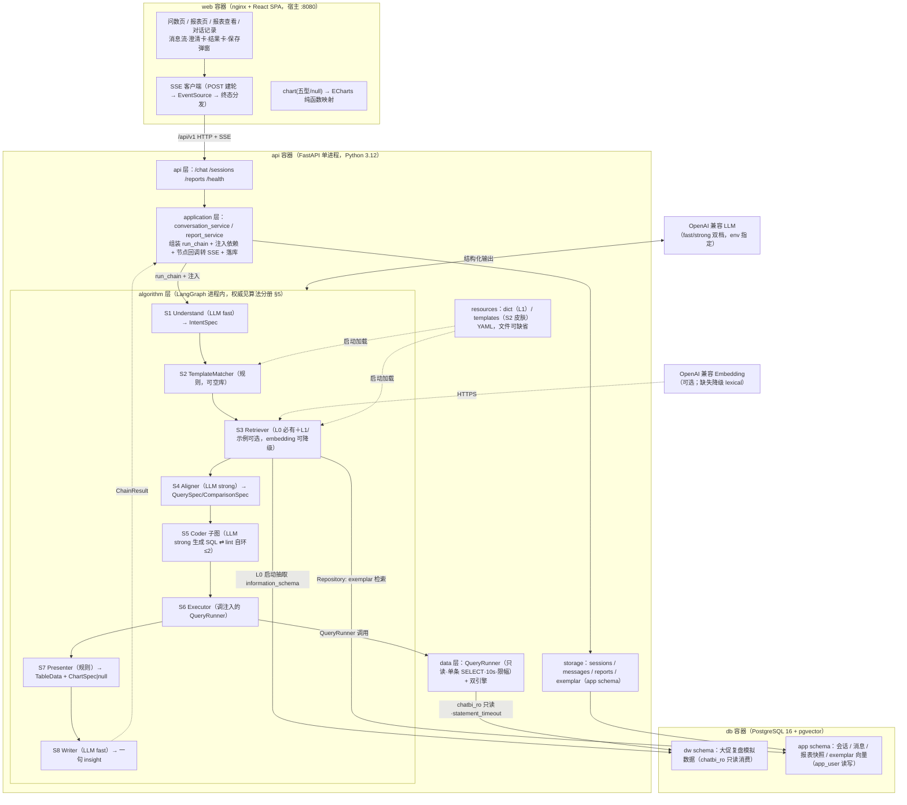
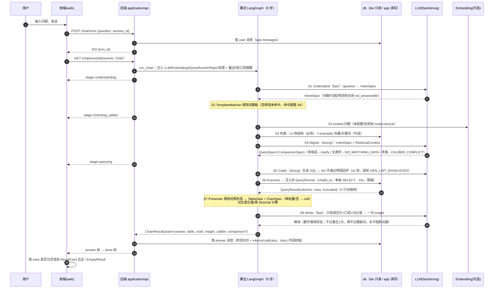
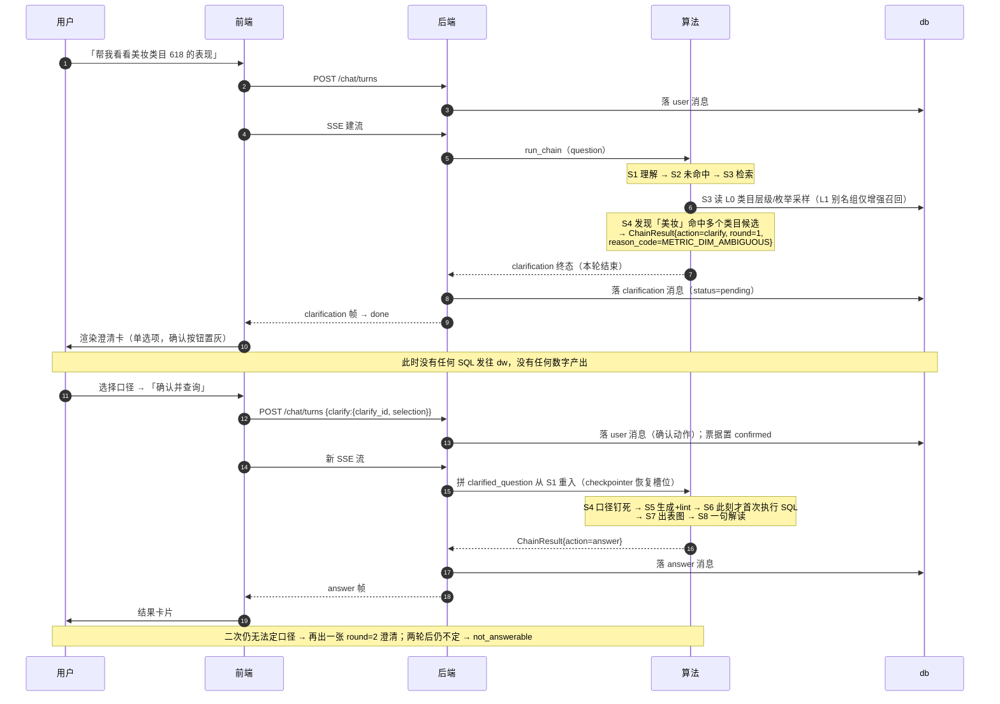
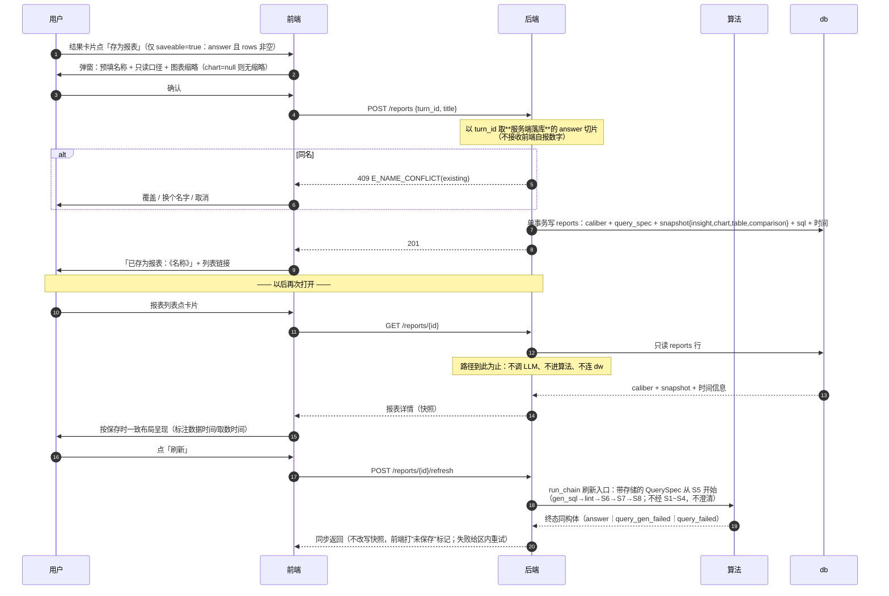

# SDD · 总览

> 版本：v0.2（P4 产出，随算法 SDD v0.4 同步重写，待评审）
> 本文件是 SDD 四份文档的入口与**对照/衔接的唯一权威**：技术方案一句话、逻辑架构、PRD 对照表、非目标、目录树、三份分册路径、三部分如何衔接。
>
> **v0.2 相对 v0.1 的范式反转（背景）**：算法链路从"LLM 只产字典内语义计划、SQL 由确定性编译器生成"改为 **8 步链路、四个 LLM 智能体**（Understand/Aligner/Coder/Writer）：**SQL 改由 Coder（LLM）生成并带 lint 自环修复**；字典/模板/示例全部从硬闸门降为可选增强——L0 库结构启动自动抽取是唯一必需上下文，可答边界＝已接入的数据库；唯一返回契约是 `ChainResult`；示例向量用同库 pgvector（不引新组件），**本地与生产统一 Supabase 托管（2026-10-17 改）**，经 Repository 接口与连接配置切换。
>
> **维护规则（定死）**：改方案先改对应分册，再回本文件同步衔接时序与对照表；本文件与分册冲突时，先修本文件的对照关系，再修分册，不允许两边长期不一致。四份文档之间只做路径引用，不复制粘贴。

---

## 1. 技术方案一句话

**ChatBI = React 单页（web 容器）+ FastAPI 单服务（api 容器）+ PostgreSQL 单库（db 容器，pgvector 镜像），由 Docker Compose 一键拉起；一次问数在前端走"POST 建轮 + SSE 收过程/终态"，在后端注入依赖调用 LangGraph 8 步链路——S1 Understand 听懂意图（非数据问题当场拒答），S2 模板快路径可选命中，S3 检索把 L0 自动抽取的库结构（必需）与 L1 口径/实体/示例（可选增强，embedding 挂了降级关键词）铺成上下文，S4 Aligner 钉成 QuerySpec（多候选澄清、无表列/口径矛盾拒答），S5 Coder 用 LLM 生成 SQL 并经 lint 自环 ≤2 轮（白名单/禁写/列归属/LIMIT），S6 通过后端注入的只读 QueryRunner 执行（算法不直连库），S7 Presenter 规则出表与图（chart 可为 null），S8 Writer 只写一句数字落地的解读；终态统一为 ChainResult（answer/clarify/rejection/error）并落库；澄清是 S4 上"确认前不出数、两轮上限"的正式出口；answer 卡片可整体快照为报表，再打开直接读快照，刷新带存储的 QuerySpec 从 S5 重跑；数据库统一为 Supabase 托管 PG+pgvector（2026-10-17 改），本机进程经 Transaction 池化直连、链路代码不动，db/api/web 三容器 Compose 保留为可选部署交付物、本版不验收。**

## 2. 逻辑架构



四条关键边界：

1. **前端不计算任何业务数字**：表/图/解读同源消费一个 `ChainResult.action=answer` 载荷（table/chart/insight），对比变化值率也由算法代码 Decimal 算好；
2. **算法不直连库、后端不生成 SQL**：Coder 只产 SQL 不持执行工具，S6 经后端注入的 QueryRunner 落库执行；SQL 合法性由算法 lint（白名单按 L0）自环把关，只读账号/超时/限幅是后端执行层兜底——两层物理分开；
3. **呈现层不碰 SQL 与库**：Presenter 规则翻译、Writer 只见本次真实行，从机制上杜绝解读编数；
4. **报表快照与问数链路物理分离**：打开报表只读 `reports.snapshot`，刷新才带 `query_spec` 从 S5 重跑。

---

## 3. 和 PRD 的对照表（F1～F9 落点）

| PRD | 能力 | 前端 | 后端 | 算法 | 本版 |
|---|---|---|---|---|---|
| F1 | 对话问数（过程可见可取消、表/图/一句解读、多轮） | ◎ 页面与全部交互（[前端](./SDD-前端.md) §3.1） | ○ 建轮/依赖注入/SSE/落库/QueryRunner | ◎ 8 步主链路（[算法](./SDD-算法应用.md) §1、§2、§3） | **演示要有** |
| F2 | 澄清（确认前不出数，两轮上限） | ○ ClarifyCard 交互（前端 §3.2） | ○ 票据落库、clarified_question 重入（[后端](./SDD-后端.md) §3.2） | ◎ S4 多候选判定/出卡/重入恢复（算法 §3-S4、§6） | **演示要有** |
| F3 | 拒答与失败引导（不编数） | ○ RejectMessage 六码分支与重试（前端 §3.3） | ○ rejection 终态落库 | ◎ S1/S4/S5/S6 四类出口（算法 §3、§6） | **演示要有** |
| F4 | 对比（同比/环比/前后时段） | ○ 对比表/trend_line·grouped_bar 渲染（前端 §3.4） | ○ QueryRunner 多时段执行、changes 透传 | ◎ ComparisonSpec 与对比模式（算法 §4） | **演示要有** |
| F5 | 一键成报表（硬门槛/同名冲突） | ○ 弹窗、置灰、覆盖三选一（前端 §3.5） | ◎ 服务端取 answer 切片事务落库（后端 §3.4/§4） | —（保存动作不进链路） | **演示要有** |
| F6 | 报表列表/打开/改名/删除/刷新/继续问 | ○ 列表与查看页全部交互（前端 §3.6） | ◎ CRUD、快照直读、刷新带 QuerySpec（后端 §3.4） | △ 仅刷新时从 S5 进入（S5～S8） | **演示要有** |
| F7 | 对话记录（列表/还原/继续/删除） | ○ 列表页+同套渲染器还原（前端 §3.7） | ◎ sessions/messages 表与接口（后端 §3.3/§4） | —（还原不重跑链路） | **演示要有** |
| F8 | 登录鉴权/多用户权限 | 预留（拦截器/路由守卫占位，不做页面） | 预留（owner_id 字段固定 default、无鉴权中间件） | — | **可暂缓**（PRD 4.8） |
| F9 | Docker Compose 部署、浏览器打开 | ○ web 镜像（nginx 托管） | ◎ compose 三服务拓扑（后端 §7） | — | **演示要有** |

◎＝主责　○＝配合　△＝部分复用　—＝不涉及。PRD 交互明细（4.1～4.9）中的每一条都能在对应分册章节找到落点；本版不新增 PRD 之外的功能。

---

## 4. 非目标（本版架构故意不做）

对齐 PRD 第 7.2 节 Out 与暂缓项，技术侧明确：

1. **不做微服务/消息队列/多 worker 分布式编排**：一个 FastAPI 进程承载全部模块，turn 注册表、事件缓冲、checkpointer 用进程内存；
2. **不做跨数据源、裸 raw 表直问**：可答范围＝已接入数据库中真实存在且可对齐的表/列（L0 启动自动抽取），dw 之外无数据入口，也不提供绕过 8 步链路直接查物理表的入口；
3. **不做仪表盘搭建、报表订阅分发、审批流**；
4. **不做归因/因果/趋势预测链路**：S1 直接判 `not_answerable(NOT_DATA_QUESTION)` 并给相关数据问法，不预埋这类 agent；
5. **不做模型后训练、多模型自动路由/编排**：一套 OpenAI 兼容配置 + fast/strong 两个固定档位（Understand/Writer=fast，Aligner/Coder=strong），换供应商/模型只改环境变量；
6. **不做登录/账号/多租户/行列级 RBAC**：仅保留 `owner_id` 字段与前端拦截器/路由守卫两个薄预留点，不建权限中台；
7. **不做跨设备同步、会话全文搜索、收藏置顶**；
8. **不做 K8s/生产 CI/CD**：交付边界为一套 `docker compose up`；
9. **不对用户暴露 SQL/堆栈/trace/错误码原文**：SQL 与 trace 仅在服务端留痕（评测与排查用）；
10. **MVP 不引入 Supabase 自托管栈、独立向量库或任何新基础设施组件**：示例向量用同库 pgvector（单表 hnsw），检索读写隔在 Repository 接口后；Embedding/L1/模板均可缺省，缺了产品照常跑。**本地与生产统一 Supabase 托管 PG+pgvector（2026-10-17 改；Auth 可承接未来 F8）**，切换只换连接配置与 Repository 实现（算法 §7.3、后端 §7.4）。

## 5. 仓库目录树草案（写死，P5 据此生成骨架）

```text
chatbi/
├─ docker-compose.yml            # db(pgvector) / api / web 三服务（F9）
├─ .env.example                  # LLM(fast/strong) + EMB(可选) + 两个数据库连接等（真实 .env 不提交）
├─ web/                          # 前端（SDD-前端.md §8 有完整子树）
│  ├─ Dockerfile                 #   node 构建 → nginx:alpine
│  ├─ nginx.conf                 #   静态托管 + /api 反代（SSE 关 buffering）+ SPA 兜底
│  └─ src/{api,store,pages,components,chart,utils}
├─ backend_service/                          # 后端
│  ├─ Dockerfile / requirements.txt
│  ├─ app/
│  │  ├─ main.py / config.py
│  │  ├─ backend_service/{routes,schemas}/           # chat / sessions / reports / health；DTO 镜像 ChainResult
│  │  ├─ application/                    # conversation_service（run_chain 装配/注入/SSE 回调）/ report_service
│  │  ├─ algorithm/                      # ★ 算法分册 §5 的完整模块树（本树不复制，只列顶层）
│  │  │  ├─ graph.py / state.py          #   8 步主图 + ChainState + ChainResult
│  │  │  ├─ agents/{understand,aligner,coder,writer}/
│  │  │  ├─ nodes/{template_match,retrieve,execute,build_view,clarify}.py
│  │  │  ├─ retrieval/{schema_extractor,lexical,vector,repo}.py
│  │  │  ├─ llm/{client,embeddings,registry}.py
│  │  │  └─ resources/{dict/,templates/}  #  L1 字典 + S2 模板 YAML（可选增强，文件可缺省）
│  │  ├─ data/{engines.py,query_runner.py}  # app 引擎 + dw 只读引擎 + QueryRunner 实现
│  │  └─ storage/{models.py,repositories.py}  # sessions/messages/reports/exemplar/meta_schema_cache
│  ├─ db/                               # 001 角色+CREATE EXTENSION vector / 002 dw DDL / 003 seed（P6）
│  └─ tests/                            # 含 mock LLM + MockQueryRunner 离线回归 T01~T15
├─ harness/                      # P5 建设：specs / skills / runner
└─ docs/                         # PRD、测例、调研纪要、SDD 四份、metrics-dictionary
```

## 6. 三份分册的路径与职责

| 分册 | 路径 | 只管什么 | 是以下内容的唯一权威 |
|---|---|---|---|
| 前端 | [docs/SDD-前端.md](./SDD-前端.md) | 页面/信息架构、每个 PRD 交互怎么实现、SSE 客户端、图表渲染、鉴权预留 | 前端组件行为与目录 |
| 后端 | [docs/SDD-后端.md](./SDD-后端.md) | 服务拆分、run_chain 调用与依赖注入、HTTP/SSE 报文（ChainResult 镜像）、存储字段、查数执行、Compose 部署、HTTP 错误码 | 接口报文与部署拓扑 |
| 算法应用 | [docs/SDD-算法应用.md](./SDD-算法应用.md) | 8 步链路、每步输入输出与成败去向、四智能体边界、澄清/拒答/对比、IntentSpec/QuerySpec、ChainResult、L0/L1/检索与模型适配 | 链路语义与 ChainResult 契约 |

辅助约定：[docs/metrics-dictionary.md](./metrics-dictionary.md) 是指标/维度/档期/数据表的**大纲级**约定（P4）；新范式下它 P6 一方面落 dw DDL/seed（L0 来源），另一方面可选择性落 L1 字典 YAML（增强，不是运行闸门）。

## 7. 三部分怎么衔接（只在本文件写）

### 7.1 一次完整问数



### 7.2 一次澄清（S4 出口，确认前不出数）



### 7.3 一次存报表、再次打开与刷新



## 8. 关键技术决策清单（一版写死，改需回本分册）

| # | 决策 |
|---|---|
| 1 | 前端 React 18 + Vite + TS + AntD 5 + ECharts 5 + Zustand；纯 SPA |
| 2 | 后端 Python 3.12 + FastAPI 单服务单 worker；SQLAlchemy 2 只管 app schema；psycopg 裸连接查数 |
| 3 | 编排 LangGraph 进程内嵌（StateGraph + Coder 子图 + checkpointer）；后端只通过 `run_chain` + 依赖注入（LLM/Embedding/QueryRunner/Repository/resources）调用算法 |
| 4 | **【相对 v0.1 的关键反转】SQL 由 Coder（LLM）生成**，算法 lint（sqlglot：L0 表白名单/禁写语句/列归属/LIMIT 注入）自环 ≤2 轮；Aligner 产 QuerySpec；**确定性 SQL 编译器取消**，后端不建 builder/guard |
| 5 | 四智能体双档模型：Understand/Writer=fast、Aligner/Coder=strong；一套 OpenAI 兼容配置，失败重试 1 次，无 key 服务照常启动 |
| 6 | 检索前置为上下文而非事后比对：L0 库结构启动自动抽取（必需、总有）；L1 字典/S2 模板/exemplar/Embedding 全为可选增强，缺失逐项降级（lexical/空库未命中），可答边界＝已接入数据库 |
| 7 | 安全三层：算法 lint → 只读角色 chatbi_ro → QueryRunner 单条 SELECT + statement_timeout=10s + 行数限幅；算法不直连库、不 import storage |
| 8 | 问数协议：POST 建轮 → SSE 三 stage（understanding/checking_caliber/querying）→ 五终态（answer/clarification/rejection/error/cancelled）→ done；**ChainResult 是返回体唯一契约**，前后端类型都镜像它 |
| 9 | 澄清是 S4 的正式出口（显式票据落库、clarified_question 从 S1 重入、两轮上限）；拒答三 action 六 reason_code；空结果是 answer（rows=[]、chart=null）；S8 严格一句、数字落地校验、失败模板兜底不阻断 |
| 10 | 报表存 answer 切片快照（insight/chart/table/comparison）+ query_spec；打开直读快照，刷新带 QuerySpec 从 S5 重跑，继续问以 inherited_spec 承接 |
| 11 | PostgreSQL 16 双 schema（dw/app）双角色；exemplar 同库 hnsw；**本地与生产统一 Supabase 托管**（2026-10-17 改），本机进程经 Transaction 池化连接；Compose db/api/web 三容器保留为可选部署交付物、本版不验收；Repository 接口预留切换 |
| 12 | 第一包数据为电商大促复盘（2025+2026 两个 618 数据覆盖）；换包 = 换 dw seed（可附 L1 资源），代码与接口不改 |

> 变更流程（对齐 AGENTS.md）：大改先改本分册/分册文档，再让 AI 改代码；接口冻结后未经确认不得修改报文与存储模型。

## 9. 下游衔接

- P5 搭 Harness：按第 5 节目录树生骨架，spec 优先覆盖四个高风险面——**ChainResult 契约前后端镜像、Coder lint 白名单自环、QueryRunner 只读注入与超时限幅、报表快照事务**；
- P6 模拟数仓：以 [metrics-dictionary.md](./metrics-dictionary.md) 为输入落 dw DDL/seed（L0 抽取对象）与角色/vector 扩展初始化；L1 字典与模板 YAML、exemplar seed 作为**可选增强**按需补充，不作为跑通前提；
- P7/P8：先用 mock LLM + MockQueryRunner 离线打通 8 步主路径，再接真实 OpenAI 兼容 API；契约就是算法分册 §6（ChainResult）与后端分册 §3；
- P11 评测：runner 直接调 `graph.ainvoke()`（不经 HTTP），以 `docs/测例.md` T01～T15 为 golden set，断言 action、reason_code、图型与关键口径字段。
