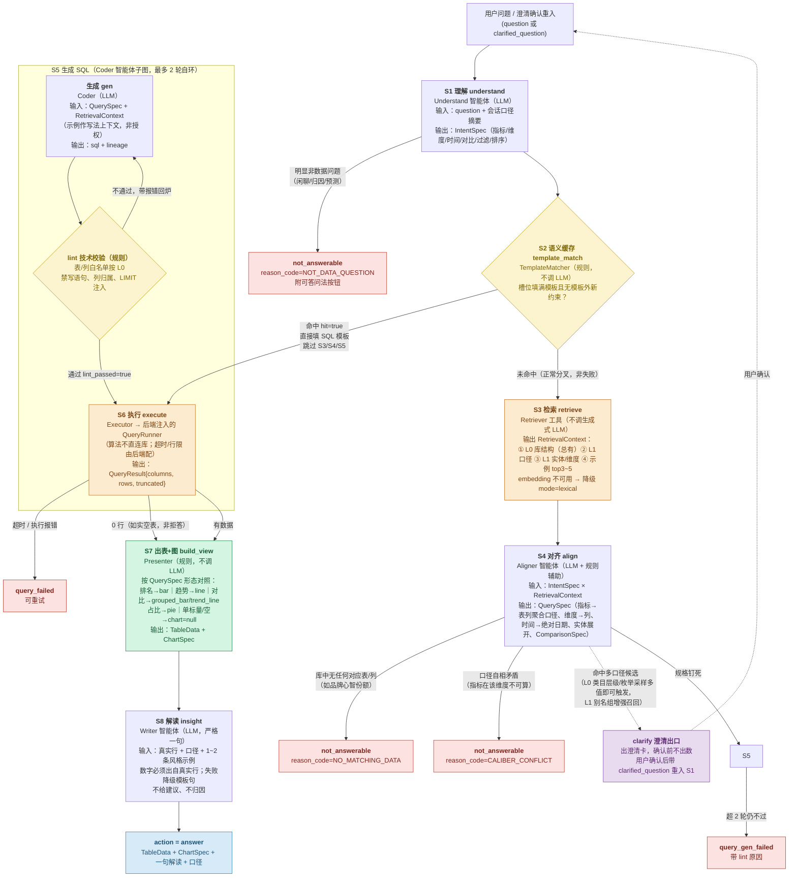

# SDD · 算法应用（v0.4 · 字典降增强 / 链路重排 / 检索前置为上下文）

## 变更说明（相对 v0.3，本次是方向性重构）
- 回应“拒答比例太高、字典不能当主链路闸门”：取消 S2 硬闸门与 `out_of_range` 拒答；字典从“运行时唯一授权源”降为可选增强层。主链路无业务字典也能跑（模型基于库结构 L0 直接生成），有字典则质量更高。拒答大幅缩减，只剩“真跑不出来”。
- 回应“Planner 跨不相邻阶段应拆开”：原 Planner 拆成 Understand（S1）与 Aligner（S4）两个独立智能体，各自提示词/模型档/单测。
- 回应“示例检索用错了，不能生成后再比对，要作为上下文影响生成”：检索（S3）前置到对齐与生成之前，召回的表/字段/口径/实体/示例全部作为 Aligner 与 Coder 的输入上下文，不是事后比对物。lint 仍是技术校验，与示例无关。
- 按用户给的新链路重排：**S1 理解 → S2 语义缓存（快路径，命中跳执行）→ S3 检索（给参考）→ S4 对齐（整理成 Coder 储备）→ S5 生成SQL → S6 执行 → S7 出表+图 → S8 解读**。
- 字典冷启动能力保留但重定位：L0 库结构（必需，自动抽取）与 L1 业务语义（可选增强）分开讲清楚。
- `ChainResult` 契约沿用新链路设计（以本文 §6 为唯一定义，后端 DTO 与前端 TS 类型均镜像它）。

> 算法链路以本文为准；`SDD-后端.md` 只写如何调用 `run_chain`、如何把 `ChainResult` 落库与返回；`SDD-前端.md` 只写按 `ChainResult.action` 渲染。`ChainResult` 是一次问数返回体的唯一权威定义，后端 DTO 与前端 TS 类型都镜像它，冲突时改本文。决策点用 **【决策】** 标注。
>
> 第一原则：主链路先跑得起来。字典/模板/检索都是叠加的增强层，有则更好，无则降级跑，不让用户因为“没配字典”就用不了产品。

---

## 1. 总链路（写死，步骤不跳）
一次问数固定 8 步。S2 是“命中即走快路径”的加速器，不是必经闸门——没命中不影响后面任何一步。



图例对应：默认蓝灰节点 = LLM 智能体（Understand/Aligner/Coder/Writer）；绿底 = 确定性规则（Presenter）；黄底 = 工具节点（Retriever）与后端能力（Executor）；菱形 = 判定点（TemplateMatcher/lint）；红底 = 拒答路径；紫底 = 澄清出口（可选增强）；虚线 = 可选路径 / 澄清重入。

- **S2 命中**：S1 抽出的槽位能填满某条模板，且无“模板外新约束”→ 直接填 SQL 模板，跳过 S3/S4/S5，去 S6 执行。这是高频问题的免 LLM 生成快路径。
- **S2 未命中**：槽位填不齐或出现模板没覆盖的新约束 → 当作未命中，老老实实走 S3→S4→S5 主流程。未命中不是失败，是正常分叉。

主流程任一步真跑不出来（生成失败、执行报错、非数据问题）才拒答。不在字典里不拒答——没字典照样基于库结构生成。

**【决策】** 没有任何一步是“没配字典就过不去的硬闸门”。字典是给模型参考的，不是通行证。

各步的角色与类型（LLM 智能体 / 确定性规则 / 工具 / 后端能力）已直接标注在流程图节点里，职责边界详见§5。
- LLM 出现在 S1/S4/S5/S8；S2/S3/S6/S7 是规则或工具或后端回调。
- 路由按状态里的显式枚举/布尔字段（`template_hit` / `lint_passed` / `action`），不解析自然语言判断走向。

---

## 2. 用一个真实请求走通全流程（链路直觉解读）
用一句真实问题把 8 步串起来，讲清每步在干什么、进什么出什么。本例对应测例 T01（§10）。

### 2.1 起点
> “今年 618 期间各渠道的 GMV 排序”

### 2.2 S1 理解 —— Understand 把“人话”翻成槽位
在干什么：LLM 把自然语言拆成结构化意图与槽位。
输出：指标=GMV；维度=渠道；时间=今年 618；排序=GMV 降序；对比=无；过滤=无。

为什么不判范围：理解与判断分开，避免 LLM 猜表。Understand 只负责“听懂”，不负责“查库授权”。

### 2.3 S2 语义缓存 —— TemplateMatcher 试模板快路径
在干什么：拿 S1 的槽位去匹配预设模板库。比如有模板：
```
模板骨架：{time}{region} GMV
槽位: time、region
SQL 模板：SELECT SUM(pay_amount-refund_amount) AS gmv
          FROM d_order WHERE order_date={time} AND region={region}
```

“今年 618 各渠道 GMV”的槽位是 `time=今年618，dimension=渠道`，与上面这条 `{time}{region}` 模板对不齐（要的是地区不是渠道）→ **未命中**。若模板库里有 `{time} 各渠道 GMV` 骨架且槽位填得满 → 命中，直接填 SQL 模板，跳到 S6。

为什么这样设计：高频问题免 LLM 生成、秒出、零幻觉。模板是运营维护的“场景皮肤”（YAML），不是平台硬编码。抽不齐或新约束就未命中走主流程，不报错不拒答。没配模板库：S2 永远未命中，全部走主流程，产品照常用。

### 2.4 S3 检索 —— 给模型参考，不是事后比对
在干什么：在 Aligner 对齐和 Coder 生成之前，把相关参考资料召回来，作为下一步的输入上下文。四类内容：

| 检索类 | 内容 | 作用 | 来源 |
| ---- | ---- | ---- | ---- |
| ① 库结构 | 表/列/类型/主外键/注释/枚举采样 | 模型必须知道表叫什么列叫什么才能写 SQL | L0 自动抽取（必需，总有） |
| ② 口径 | GMV=支付金额-退款 等公式与口径过滤 | 告诉模型业务怎么算，不用从列名猜 | L1 业务字典（可选增强） |
| ③ 实体/维度 | 江浙沪=浙江+江苏+上海；渠道枚举 | 用于约束展开，别把“华东”漏了 | L1 业务字典（可选增强） |
| ④ 典型复杂需求 | (问法，SQL，图型) 示例 | 教模型这类问题怎么写，压幻觉 | 示例库（可选增强） |

关键：检索结果直接进提示词作为上下文，影响 Aligner 的对齐决策和 Coder 的 SQL 生成质量。不是生成完再拿示例去比对。lint 是独立的技术校验（防 DROP/列错），跟示例无关。没配 L1/示例：S3 只返回 L0 库结构，Aligner/Coder 基于 L0 硬跑，质量低但能用。有 L1/示例则质量显著提升。

### 2.5 S4 对齐 —— 把人话意图钉成可查规格
先和前后两步分开，才不会混：
- S1 只听懂用户想看什么（指标=GMV、切法=渠道、时间=今年 618），这时还不知道表、列、日期。
- S3 只把可能用得上的参考摊开（库结构、口径、实体、示例），这时还是一堆资料，尚未拍板。
- S4 才拍板：把每一个槽位对上库里的具体东西。对齐完，S5 Coder 不必再猜业务口径，只负责把规格翻译成 SQL。

在干什么：Aligner 拿着 S1 的意图 + S3 的检索结果，整理成一份无歧义的查询规格 `QuerySpec`。所谓对齐，就是「人话意图 × 检索到的参考 → 定规格」——不是再理解一遍问题，也不是去查库。

输出（接上面那句「今年 618 各渠道 GMV」）：
- GMV → 表 `d_order`，`SUM(pay_amount - refund_amount)`，过滤 `pay_status=已支付`
- 渠道 → 列 `channel_name`
- 今年 618 → 具体日期 `2026-06-01 ~ 2026-06-20`（口头档期变成可查区间）
- 排序 → GMV 降序
- 若用户说了「华东」，这里展开成省份列表，避免后面写 SQL 漏省

为什么要单独一个智能体：听懂人话（S1）和对上表结构（S4）是两种能力。混进 Coder 里，既要决定「GMV 怎么算」又要写出合法 SQL，后面无法单独优化。规格错了找 Aligner，SQL 写废了找 Coder。

没配字典时：基于 L0 库结构 + 列注释对齐，质量低但能跑，不在这一步因为没字典而拒答。

### 2.6 S5 生成 SQL —— Coder 带上下文生成 + 自检自修复
在干什么：Coder 智能体把 `QuerySpec` 翻译成 SQL。S3 检索到的示例和库结构片段作为上下文进提示词影响生成质量。生成完做 lint（表白名单、禁写语句、列归属），不过带报错回炉，最多 2 轮。

输出：
```sql
SELECT channel_name, SUM(pay_amount - refund_amount) AS gmv
FROM d_order
WHERE pay_status = '已支付' AND order_date BETWEEN '2026-06-01' AND '2026-06-20'
GROUP BY channel_name ORDER BY gmv DESC
```

示例的作用是输入不是裁判：示例教模型“排名类问题该用 GROUP BY + ORDER BY 这套写法”，但示例里出现的表不等于授权（lint 白名单仍按本次场景的实际表校验）。模型生成时“参考写法”，lint 校验“技术合法性”，两件事分开。

### 2.7 S6 执行 —— 算法不碰库
Executor 把 SQL 交给后端 `QueryRunner` 执行，拿回 `QueryResult`。超时/报错 → `query_failed`；空结果 → 如实返回空表 + 一句“该范围无数据”（不再算拒答）。执行权和库权限在后端。

### 2.8 S7 出表 + 图 —— Presenter 规则呈现
在干什么：不调大模型。把 S6 查回来的行，按 S4 已经钉死的查询规格，组织成一张表 + 一份图描述（`TableData` + `ChartSpec`）。算法只说「画什么图、X 轴是谁、系列是谁」，ECharts 具体怎么画由前端翻译。

图类型怎么定（不看「数据好不好看」，只看规格形态）：S1/S4 已经识别过这是排名、趋势还是对比。S7 做一张对照表：

| 规格里已经有的形态 | 怎么判断 | 出什么图 |
| ---- | ---- | ---- |
| 排名 / TopN | 有维度、有排序（如各渠道 GMV） | 柱状 `bar` |
| 趋势 | 有时间序列、看走势（如三天渠道 GMV） | 折线 `line` / `trend_line` |
| 对比 | 有 `ComparisonSpec`（同比/环比/前后时段） | 分组柱状 `grouped_bar`，或对比折线 `trend_line` |
| 占比 / 结构 | 有分组且看构成（如新老客 GMV 占比） | 饼图 `pie` |
| 单标量 | 只有一个数、没有可画的切分维度（如「618 GMV 总额是多少」） | 不画图，`chart=null`，只出表 |
| 空结果 | S6 没有行 | 表为空，不硬画图 |

表始终出：列名用规格里的业务名，行就是查询结果。图出不了也不算失败，照常 answer。

接上面那句 618 各渠道 GMV：规格是「按渠道排名」，S7 就出柱状图，X 轴渠道、系列 GMV；不会在这一步再问模型「要不要画饼图」。

### 2.9 S8 解读 —— Writer 一句话
Writer 读真实行 + 口径 + 图表，产出严格一句解读，附 1~2 条风格示例控格式。数字必须来自真实行；失败降级模板句。不给建议、不归因。

### 2.10 出口与分叉
- 正常 → `action=answer`：表 + 图 + 一句解读。
- 模板快路径命中 → 同样 answer，只是省了 S3/S4/S5。
- 拒答大幅缩减：只有 `not_answerable`（真不是数据问题）、`query_gen_failed`（生成+lint 超轮失败）、`query_failed`（执行报错）。不在字典里、没配模板、没示例——都不拒答，照常跑。

---

## 3. 每一步详述
格式：谁做 / 输入 / 输出 / 成功去哪 / 失败去哪。

### S1 理解问题（understand · Understand 智能体）
- **谁做**：Understand 智能体（LLM，结构化输出）。
- **输入**：`question`；可选 `clarified_question`（澄清重入时）；可选少量意图解析示例。
- **输出**：`IntentSpec`：指标、维度、时间窗、对比类型、过滤条件、排序/TopN，以及槽位形态（供 S2 模板匹配用）。
- **成功去哪**：S2。
- **失败去哪**：明显非数据问题 → `not_answerable`；模型异常 → `error`（重试 1 次）。

### S2 语义缓存匹配（template_match · TemplateMatcher，规则）
- **谁做**：规则模板匹配（`nodes/template_match.py`）；不调 LLM。
- **输入**：`IntentSpec` + 模板库（YAML，场景皮肤，可空）。
- **输出**：`TemplateMatch{ hit: bool, template_id, sql, chart_type, bindings }`。命中且槽位填满且无模板外新约束 → `hit=true` + 填好的 SQL。
- **分支**：命中 → 跳 S6；未命中 → S3。
- **失败去哪**：模板库为空或无匹配 → 未命中，走 S3，不算失败。
- **要点**：高频问法免 LLM 生成；【决策】模板库是可选皮肤，空库则永远未命中、全程走主流程，产品仍可用。模板只覆盖“骨架+槽位填得满”的问法，抽不齐或有新约束一律未命中。

### S3 检索（retrieve · Retriever 工具）
- **谁做**：双通道检索工具（`retrieval/`）；不调生成式 LLM（embedding API 除外）。
- **输入**：`IntentSpec`（关键词来自指标/维度/时间）。
- **输出**：`RetrievalContext{ schema_blocks[], caliber_defs[], entity_defs[], exemplars[], mode }`。
  - ① 库结构片段（L0，总有）
  - ② 口径定义（L1，有则返回）
  - ③ 实体/维度展开规则（L1，有则返回）
  - ④ 典型需求示例（示例库，有则返回 top 3~5）
- **成功去哪**：S4（也供 S5 Coder 复用，不必再检一次）。
- **失败去哪**：embedding 不可用 → 降级纯关键词检索；`mode=lexical`，trace 标注；连关键词都无（L0 没抽到）→ 返回空上下文，S4/S5 基于 IntentSpec 硬跑。
- **要点**：检索是给模型做参考，不是授权；【决策】检索结果作为 S4/S5 的输入上下文，影响生成质量，不做事后比对。

### S4 对齐（align · Aligner 智能体）
- **谁做**：Aligner 智能体（LLM + 规则辅助）。
- **输入**：`IntentSpec` + `RetrievalContext`（库结构/口径/实体/示例）。
- **输出**：`QuerySpec`：指标→表/列/聚合/口径过滤；维度→列；时间→具体日期或档期；实体展开；对比类产出 `ComparisonSpec`（§4）。
- **成功去哪**：S5。
- **失败去哪**：
  - 指标/维度值命中多个候选口径 → `clarify`（确认前不出数）。触发不依赖预配字典：L0 类目层级/枚举采样发现多值可匹配（如「美妆」同时命中多个类目值或分属多级类目）即触发；L1 别名组只是进一步增强召回；
  - 库中无任何可对应表/列（如品牌心智份额）→ `not_answerable(NO_MATCHING_DATA)`；
  - 对齐后口径自相矛盾（指标在该维度不可算）→ `not_answerable(CALIBER_CONFLICT)`。
- **要点**：S4 定规格、不写 SQL。Aligner 把 S1 意图对上 S3 参考，输出 Coder 能直接用的 QuerySpec；【决策】无 L1 时基于 L0 库结构+列注释对齐，质量低但能跑，不拒答。

### S5 生成 SQL（gen_sql · Coder 智能体子图）
- **谁做**：Coder 子图（`agents/coder/`）：取上下文（复用 S3 结果）→ 生成（LLM）→ lint（规则）→ 不通过回炉修复，最多 2 轮。
- **输入**：`QuerySpec` + `RetrievalContext`（示例与库结构片段作为生成上下文）。
- **输出**：`sql` + `lineage`（表/列/口径/ exemplar_ids ）。
- **失败去哪**：lint 超轮仍不过 → `query_gen_failed`（带 lint 原因）。
- **要点**：【决策】 SQL 只能在库实际存在的表/列上生成（lint 按 L0 白名单校验）；示例是写法参考不是授权；Coder 不持有执行工具。

### S6 执行（execute · 后端回调）
- **谁做**：Executor 调后端注入的 `QueryRunner`；算法不直连库。
- **输入**：`sql`。
- **输出**：`QueryResult{ columns, rows, row_count, truncated }`。
- **失败去哪**：超时/报错 → `query_failed`；空结果 → 不再拒答，如实返回空表，S8 解读“该范围无数据”。
- **要点**：超时与行数上限由后端配置（`SDD-后端.md §6`）。

### S7 出表 + 图表配置（build_view · Presenter，规则）
- **谁做**：规则（不调 LLM）。
- **输入**：S6 的 `QueryResult` + S4 的 `QuerySpec`（含对比形态、排序/TopN、时间维度）。
- **输出**：`TableData` + `ChartSpec`。图类型由规格形态对照：排名→`bar`，趋势→`line / trend_line`，对比→`grouped_bar / trend_line`，占比→`pie`，单标量或空结果→`chart=null`。
- **失败去哪**：原则上不失败；不适合图表则只出表，仍 answer。
- **要点**：S7 不重新判断「这个问题适合什么图」；形态在 S1/S4 已钉死，本步只做对照翻译，算法出结构化描述，ECharts option 由前端生成。

### S8 生成一句解读（insight · Writer 智能体）
- **谁做**：Writer 智能体（LLM，结果约束）+ 1~2 条风格示例。
- **输入**：S6 的 `QueryResult`（真实行，已限幅）+ S4 的 `QuerySpec` 口径摘要 + S7 的 `ChartSpec`；对比类另附代码算好的变化值/变化率（见 §4，Writer 不自己算）。
- **输出**：`insight`（严格一句中文）。
- **约束**：数字必须出自真实行或代码算好的对比值；只陈述事实（谁最高、占比多少、同比升/降几个点），不给建议、不归因、不预测；风格示例只控格式不供数字。空结果固定输出「该范围无数据」语义的一句，不编造。
- **成功去哪**：组装 `ChainResult{ action=answer, table, chart, insight, caliber }`，链路结束。
- **失败去哪**：落地校验（正则抽取解读中的数字，逐一核对是否出自真实行/对比值，容忍格式化误差）不通过 → 重生成 1 次；仍不通过 → 降级模板句（规则按事实拼装，如「渠道 A 的 GMV 最高，占全渠道约 42%」），trace 标注。**解读失败永不阻断出数**：表和图照常 answer。
- **要点**：Writer 拿不到 SQL、拿不到数据库，它的世界里只有本次查出来的行——从机制上杜绝解读编数（PRD 第 8 节「解读只引用本次结果中存在的数字」）。

---

## 4. 对比类问题（ComparisonSpec）
同比、环比、自定义前后时段不是独立分支，而是 S1 识别出对比意图、S4 在 `QuerySpec` 上挂一份 `ComparisonSpec`，后续节点按对比模式工作。

```text
ComparisonSpec
├─ mode        yoy | mom | custom          同比 | 环比 | 自定义前后时段
├─ periods[]   [{key, label, start, end}]  2~3 段绝对区间（档期三段对比为 3 段）
└─ value_fields[]  参与对比的指标（随 QuerySpec.metrics）
```

各环节与普通取数的不同：

| 环节 | 对比模式的差异 |
|---|---|
| S1 | 识别对比词（同比/环比/vs/和…比）并抽出对比双方；只说「环比」而无当前周期语境（无上文、无档期默认）→ 按缺时间处理：有 L1 日历时用默认档期，无则澄清选周期 |
| S4 | 把「大促前一周 / 去年同期」等口头时段归一化为 2~3 段**绝对日期**（有 L1 time-calendar 查配置，无则由模型按常识推并在口径里明示）；所需时段明显超出库内数据覆盖 → `not_answerable(NO_MATCHING_DATA)` 并给可答替代（如同比不行建议环比） |
| S5 | Coder 生成带 `period_key` 的多时段聚合 SQL（一条 UNION ALL 或按时段分组），lint 照常校验 |
| S6 | 按 `period_key` 校验各时段齐备；某时段 0 行 → 该段如实为空，变化率分母为 0 标「不可比」，不编无穷大 |
| S7 | 图走 `grouped_bar` / `trend_line`；**变化值、变化率由代码用 Decimal 计算**（金额 2 位、率 1 位），不让模型算 |
| S8 | 解读只陈述方向与幅度（「GMV 同比增长 18.3%」），禁止解释原因 |

## 5. 角色与模块职责边界
四个 LLM 智能体 + 四个规则/工具节点，各自独立提示词、独立模型档、独立单测；规格错了找 Aligner，SQL 写废了找 Coder，互不越界。

| 角色 | 类型 | 输入 → 输出 | 建议模型档 | 失败出口 |
|---|---|---|---|---|
| Understand（S1） | LLM 智能体 | question+口径摘要 → IntentSpec | 快档 | not_answerable / error |
| TemplateMatcher（S2） | 规则 | IntentSpec+模板库 → hit+SQL | —（不调 LLM） | 未命中走主流程（非失败） |
| Retriever（S3） | 工具 | IntentSpec → RetrievalContext | embedding API | 降级 lexical / 空上下文 |
| Aligner（S4） | LLM 智能体 | IntentSpec×RetrievalContext → QuerySpec | 强档 | not_answerable / clarify |
| Coder（S5） | LLM 智能体子图 | QuerySpec+上下文 → sql+lineage；lint 自环 ≤2 轮 | 强档 | query_gen_failed |
| Executor（S6） | 后端回调 | sql → QueryResult | — | query_failed |
| Presenter（S7） | 规则 | QueryResult+QuerySpec → TableData+ChartSpec | — | 不失败（无图则 chart=null） |
| Writer（S8） | LLM 智能体 | 真实行+口径+对比值 → 一句解读 | 快档 | 降级模板句（不阻断） |

目录结构（与 §9 编排对应，写死）：

```text
algorithm/
├─ graph.py                 # LangGraph 主图：节点注册 + 条件边路由
├─ state.py                 # ChainState 黑板 + ChainResult 定义（§6）
├─ agents/                  # 四个 LLM 智能体，各自独立目录
│  ├─ understand/  {node.py, prompts.py, agent_schemas.py}
│  ├─ aligner/     {node.py, prompts.py, agent_schemas.py}
│  ├─ coder/       {subgraph.py, gen.py, lint.py, prompts.py, agent_schemas.py}
│  └─ writer/      {node.py, prompts.py, agent_schemas.py, style_examples.yaml}
├─ nodes/                   # 规则/工具节点（不调生成式 LLM）
│  ├─ template_match.py     # S2
│  ├─ retrieve.py           # S3 编排双通道检索
│  ├─ execute.py            # S6 调后端注入的 QueryRunner
│  ├─ build_view.py         # S7 Presenter
│  └─ clarify.py            # 澄清卡构造（可选增强出口）
├─ retrieval/
│  ├─ schema_extractor.py   # L0：启动时从 information_schema 抽库结构+列注释+枚举采样
│  ├─ lexical.py            # 关键词通道（总有，兜底）
│  ├─ vector.py             # 向量通道（pgvector，可选增强）
│  └─ repo.py               # 资源读写 Repository 接口（§7 可换实现）
├─ resources/               # 资源文件（Git 版本化，§7）
│  ├─ dict/                 # L1 业务字典 YAML（可选增强）
│  └─ templates/            # S2 模板库 YAML（可选皮肤）
├─ llm/
│  ├─ client.py             # LLMClient 抽象 + OpenAI 兼容实现（§8）
│  ├─ embeddings.py         # EmbeddingClient 抽象（§8）
│  └─ registry.py           # 模型档配置：节点 → 档位 → 具体模型
└─ requirements.txt         # langgraph / langchain / langchain-openai / psycopg[binary]
```

边界铁律：
1. **Coder 不持有执行工具，Executor 不调 LLM**——生成与执行物理分开；
2. **Writer/Presenter 不碰 SQL、不碰库**——呈现层只认 QueryResult 与 QuerySpec；
3. **Understand 不做范围授权判断**——「听懂」和「查库」分离，避免 LLM 猜表；
4. 节点间只传 `ChainState` 里的强类型字段（IntentSpec / QuerySpec / RetrievalContext / QueryResult / ChainResult），不传递自然语言中间态；
5. 评测 runner 直接调 `graph.ainvoke()` 跑全链路，不经 HTTP。

## 6. ChainResult 契约（一次问数返回体的唯一权威）
后端 DTO 与前端 TS 类型镜像本定义；字段冲突时改本文，前后端跟随。

```text
ChainResult
├─ action        answer | clarify | not_answerable | query_gen_failed | query_failed | error
├─ answer?       action=answer 时存在：
│  ├─ table      TableData{ columns:[{field,label,format}], rows[], truncated, display_limit }
│  ├─ chart      ChartSpec | null   { type: bar|line|trend_line|grouped_bar|pie,
│  │                                  x_field, series:[{field,label}], switchable[] }
│  ├─ insight    string（严格一句；空结果时为「该范围无数据」语义句）
│  ├─ caliber    { summary: string,                          一行口径（业务语言）
│  │               detail:{ metrics[], dimensions[], time_range, filters[], comparison? } }
│  └─ comparison? { mode, periods[], changes:[{key, value_delta, rate_delta|null}] }
│                  null 的 rate_delta = 分母为 0「不可比」，前端原样呈现
├─ clarify?      action=clarify 时存在（确认前不出数）：
│  ├─ clarify_id / round(1|2) / title
│  ├─ reason_code  METRIC_DIM_AMBIGUOUS | MISSING_TIME | VAGUE | ANAPHORA_UNRESOLVED
│  ├─ input_type   single_choice | time_quick | question_suggestions
│  ├─ options[]    {value, label}        suggestions[] {question}
│  └─ allow_custom_text: true            「我换个问法」
├─ rejection?    action ∈ {not_answerable, query_gen_failed, query_failed} 时存在：
│  ├─ reason_code  not_answerable:   NOT_DATA_QUESTION | NO_MATCHING_DATA | CALIBER_CONFLICT
│  │               query_gen_failed: GEN_LINT_EXHAUSTED（带 lint 原因）
│  │               query_failed:     QUERY_TIMEOUT | QUERY_ERROR
│  ├─ reason_text  大白话业务文案（不暴露 SQL/堆栈/技术码）
│  └─ suggestions[] {label, question}  可点击的可答问法；归因类固定「不算原因，可给相关数据」
├─ error?        action=error 时存在：{code, message, retryable}   LLM/内部故障，前端给重试
├─ trace         { path[], template_hit, retrieval_mode, lint_rounds, llm_calls, elapsed_ms }
├─ meta          { turn_id, question }
├─ query_spec?   QuerySpec | null（仅服务端消费：本次对齐产出的规格，messages.internal 落库、
│                报表保存/刷新/recalibrate 的依据；前端镜像不含此字段）
└─ sql?          string | null（仅服务端消费：S5 生成、S6 执行的 SQL，落 internal；
                 lint 未通过/未执行时为最后一次生成的 SQL 或 null；前端镜像不含此字段）
```

约定：
1. **空结果是 answer 不是拒答**：`action=answer`，`table.rows=[]`、`chart=null`、`insight` 为「该范围无数据」语义句，caliber 照给；
2. 一个 ChainResult 恰好命中一个 action，对应载荷字段有且仅有一个非空；
3. `clarify` 重入：后端把用户选择拼成 `clarified_question` 随下一轮调 `run_chain`，链路从 S1 重入（checkpointer 恢复槽位，见 §9）；
4. 过程状态（理解/检索/取数中）不走 ChainResult，由后端在调用 `run_chain` 期间按节点回调上抛（后端文档）；
5. `trace` 仅供评测与排查，前端不展示；
6. `query_spec`/`sql` 为**仅服务端字段**：只允许落 `messages.internal` 与报表存储，禁止出现在任何前端报文（SSE 帧/会话还原/报表出参）；前端 TS 类型镜像不含这两个字段。

## 7. 存储设计（资源文件 / 向量 / 业务库 / 本地与生产形态）
新方案引入三类新存储对象，全部落在 PostgreSQL 16 + Git 仓库内：**存储形态统一为 Supabase 托管**（本地与生产同一套，见 §7.3），**不新增基础设施组件**。

### 7.1 三类对象怎么存

| 对象 | 内容 | 存储 | 理由 |
|---|---|---|---|
| L0 库结构 | 表/列/类型/主外键/注释/枚举采样 | 启动时 `schema_extractor` 从 `information_schema`+`pg_catalog` 自动抽取，进程内缓存；可选落 `meta_schema_cache` 表加速重启 | **必需、总有**：不要求用户提供任何文件，冷启动即可跑——这是「无字典也能用」的根基 |
| L1 业务字典 | 口径公式、实体/维度别名组（江浙沪=浙+苏+沪）、歧义组（美妆）、time-calendar | `algorithm/resources/dict/*.yaml`，Git 版本化，启动加载、改动重载 | 可选增强；YAML 人类可维护、可 review、可 diff，比入库更适合「运营维护的资源文件」 |
| S2 模板库 | 骨架+槽位+SQL 模板+图型 | `algorithm/resources/templates/*.yaml`，同上 | 可选皮肤；空库=永远未命中，主流程照跑 |
| 示例库 | (问法, SQL, 图型, 标签, 来源) + 向量 | **PG 表 + pgvector**：`exemplar(id, question, sql, chart_type, tags[], embedding vector(N), source, enabled, created_at)` | 需要向量相似度检索，必须入库；pgvector 与既有 PG 同库部署，零新组件 |
| 检索索引 | exemplar.embedding 的 ANN 索引 | pgvector `hnsw` 索引 | 单表万级规模足够；不上独立向量库（PRD Out 不过度设计） |

向量维度 `N` 由 `EMB_DIM` 环境变量声明，建表与写入前校验一致——换 embedding 模型时改配置并重建该表（示例库是可再生的增强层，重建代价低）。

### 7.2 业务数据库
会话/消息/报表快照仍按 `SDD-后端.md` 的 app schema 设计，本文不重复。算法侧只新增上表中的 `exemplar` 与可选的 `meta_schema_cache`（归 app schema，由后端迁移脚本统一建）。算法**不直接写任何业务表**；澄清 ticket、ChainResult 落库全部由后端完成。

### 7.3 存储形态：统一 Supabase 托管
**【决策｜2026-10-17 改】本地与生产同一形态，数据能力不变：**

- **统一走 Supabase 托管 PG+pgvector**：本地开发、演示验收与生产均连接 Supabase 云端库（dw/app schema 与 exemplar 向量同实例），本机只跑后端/前端进程，不起任何容器。连接走 Transaction 池化（`*.pooler.supabase.com:6543`，sslmode=require；驱动侧 prepare_threshold=0，由后端轮次落地）。
- **Compose 三容器（db/api/web，pgvector 镜像）保留为可选部署交付物**：仓库内文件不动，本版不做镜像构建与端到端验收（frontend-pages OQ-2 随之关闭）；未来要验一键部署仍可 `docker compose up --build`。
- 能力重合不变：Supabase 本质是「托管 PostgreSQL + pgvector + Auth + Storage」，向量与应用数据能力与 PG16+pgvector 完全重合；Auth 供未来 F8 鉴权落地时直接承接，无需自建权限中台。

**切换预留（不变）**：检索与示例读写全部走 `retrieval/repo.py` 的 Repository 接口（`search_exemplars / upsert_exemplar / load_schema_cache`），连接配置即环境变量，**8 步链路代码不动**。

## 8. 模型适配（LLM / Embedding 商业 API 接口）
具体供应商未定，代码里**不出现任何厂商名**，全部走环境变量 + 接口抽象。

### 8.1 LLM（生成）
- **接口**：`LLMClient.complete(messages, schema) -> structured`，OpenAI 兼容 chat completions + 结构化输出（JSON schema / function calling）；DeepSeek、通义、智谱、OpenAI 等凡是兼容该协议的商用 API 都可接入。
- **配置**：`LLM_BASE_URL` / `LLM_API_KEY` / `LLM_MODEL` 为全局默认；`LLM_MODEL_FAST` / `LLM_MODEL_STRONG` 两个档位，节点按 §5 表格取档（Understand/Writer=fast，Aligner/Coder=strong），不指定则回落 `LLM_MODEL`。换模型=改环境变量，不改代码。
- **行为**：超时 `LLM_TIMEOUT_SECONDS`（默认 30）；节点内失败重试 1 次，仍失败 → `action=error(E_LLM_UNAVAILABLE, retryable=true)`，不出半截结果；结构化输出不合 schema 视同失败重试。
- **客户端工厂延迟构建**（`llm/client.py`）：未配置 key 时服务照常启动，仅问数时返回 error，便于评测用 mock 跑全链路。

### 8.2 Embedding（检索增强，可选）
- **接口**：`EmbeddingClient.embed(texts) -> vectors`，OpenAI 兼容 embeddings 接口；配置 `EMB_BASE_URL` / `EMB_API_KEY` / `EMB_MODEL` / `EMB_DIM`。
- **降级**：未配置或调用失败 → S3 自动 `mode=lexical`（纯关键词通道），trace 标注；产品照常用，召回质量降级。**Embedding 是增强不是依赖**，与「字典可选」同一原则。
- **写入侧**：示例入库/更新时才调 embed；检索侧每问一次 embed 问题文本，加进程内短缓存（同问题 5 分钟不重复 embed）。

### 8.3 评测/开发态
`LLMClient`/`EmbeddingClient` 均有 mock 实现：`MockQueryRunner + mock LLM` 可离线跑通 T01~T15 全链路回归（§9），CI 不依赖任何商用 API key。

---
## 9. 编排框架
LangGraph（StateGraph + 子图 + checkpointer）做编排，LangChain 做模型/工具/embedding 抽象。

- 主图节点即各角色；`add_conditional_edges` 按 `template_match.hit`、`lint_passed`、`final_action` 等显式字段路由。
- Coder = compiled subgraph，内部含回边。
- `ChainState` 黑板流转，交接字段即状态字段。
- `checkpointer` 支撑澄清重入。
- LLM 节点 `prompt | llm.with_structured_output(Schema)`，Schema 集中在各 `agent_schemas.py`，节点真正消费；LLM 客户端工厂延迟构建。
- 节点级函数：`MockQueryRunner + mock LLM` 跑全链路；T01~T15 固定回归集。
- 【决策】 不做自由 agent swarm；确定骨架 + 节点内有限自治（仅 Coder 自环）。
- `algorithm/requirements.txt` 锁定 `langgraph / langchain / langchain-openai`；模型与 baseURL 由环境变量配置（`SDD-后端.md §6`）。

---

## 10. 第一包测例落点
链路视角看 T01~T15 分别落在哪几步、走哪个出口。原则：**全部测例不依赖预配业务字典**——基于 L0 库结构即可跑出期望结果；有 L1 时 T09 的澄清召回、T07/T08 的档期精度进一步增强，期望结果不变。

| 测例 | 结果类型 | 链路落点 |
| ---- | ---- | ---- |
| T01 各渠道 GMV 排序 | 表+图 | 全路径；S2 可命中 `{time}各渠道 GMV` 模板快路径；未命中走 S3→S4→S5，Coder 召回 ranking 示例；S7 出 `bar` |
| T02 渠道转化率最高+柱状图 | 图 | S4 对齐转化率口径（有 L1 用字典公式，无则依列注释推断）；S7 `bar`，S8 事实卡取最大值 |
| T03 大促三天各渠道 GMV 趋势 | 图 | S1 时间=6/16-6/18；S4 grain=day；S7 多系列 `trend_line` |
| T04 退货率 Top3 类目 | 表 | S1 排序+TopN=3；S4 类目维度；S5 LIMIT 3；S7 `bar`/表 |
| T05 美妆退货率是否超 8% | 解读 | 「美妆」在已接入类目数据中命中多候选（L0 层级/枚举采样触发，L1 别名组增强）→ S4 出 `clarify`；确认后重入 S1 直达 S4 出判定解读。S8 只陈述「超过/未超过 8%」判定事实，不写建议 |
| T06 客单价 AOV | 表+解读 | S4 对齐 AOV 口径（有 L1 用唯一公式 GMV/支付订单数；无则模型从列名推断并在 caliber 明示）；单标量 → `chart=null` 只出表 + 一句解读 |
| T07 档期三段环比 | 图+表 | §4 对比模式：S4 挂 `ComparisonSpec{mode:mom/custom, periods:3段}`；变化率代码计算；S7 `grouped_bar`；档期日期有 L1 time-calendar 则精确，无则模型推绝对日期并明示 |
| T08 同比去年 618 | 表+解读 | §4 对比模式 `mode:yoy`；S4 校验去年同期库内有数（无则 `not_answerable(NO_MATCHING_DATA)` 并建议环比）；S8 只说方向与幅度 |
| T09 「美妆」类目表现 | 澄清 | **clarify 出口的验收锚点（不依赖预配字典）**：L0 类目层级/枚举采样发现「美妆」多候选（L1 别名组进一步增强召回）→ S4 出 `action=clarify`（`reason_code=METRIC_DIM_AMBIGUOUS`），确认前不执行 SQL；两轮仍不定转 `not_answerable` |
| T10 品牌心智份额 | 拒答 | S3 检索无任何相关 schema 块 → S4 找不到可对应的表/列 → `not_answerable(NO_MATCHING_DATA)` + 引导可问指标按钮（GMV/转化率/退货率/AOV） |
| T11 各档期 GMV | 表/图+解读 | 档期维度有 L1 time-calendar 则按预热/正式/返场精确切；无则按日期列分布推断。S8 只做描述性陈述，不归因 |
| T12 那个渠道按天展开 | 图+表 | 多轮：S1 输入带会话最近口径摘要（渠道语境）→ 指代消解成功 → grain=day；消解失败 → `clarify(ANAPHORA_UNRESOLVED)`；S7 `trend_line` |
| T13 新老客 GMV 占比 | 图+表 | S1 识别占比意图；S7 `pie`（§2.8 占比形态）；解读陈述两组占比 |
| T14 GMV Top3 类目 | 表 | 同 T04 形态换指标；LIMIT 3，`truncated` 标记验证 |
| T15 为什么退货率上升 | 拒答+引导 | S1 判为归因（非数据问题）→ `not_answerable(NOT_DATA_QUESTION)`，reason_text 固定「我不算原因，但可以给你相关数据」+ 附「各档期/各品类退货率」问法按钮；用户点了才走正常链路查数 |

回归保障：T01~T15 全部进 §9 的固定回归集，用 mock LLM + MockQueryRunner 断言每条测例的 `action`、图型、关键口径字段；其中 T09 断言 `clarify`、T10/T15 断言 `not_answerable` 及其 `reason_code`。