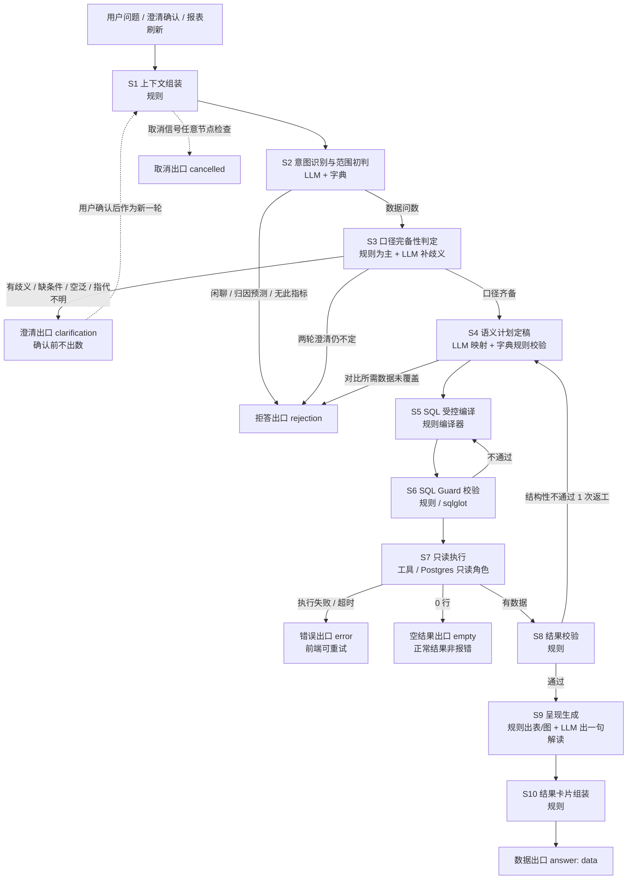

# SDD · 算法应用技术方案

> 版本：v0.1（P4 产出，待评审）
> 本文只负责一件事：**一次问数从"自然语言问题"到"结果卡片"这条智能链路怎么跑完**，包括每一步的输入/输出、成功与失败去向、澄清与拒答两个正式出口、模块边界、状态交接字段。
> 接口怎么暴露、怎么落库、怎么部署看 [SDD-后端.md](./SDD-后端.md)；页面怎么承接看 [SDD-前端.md](./SDD-前端.md)；全局对照看 [SDD-总览.md](./SDD-总览.md)。
> 指标/维度/档期的具体约定看 [metrics-dictionary.md](./metrics-dictionary.md)（本版只允许在该字典范围内答）。

---

## 1. 技术决策（写死一版）

| 决策点 | 结论 | 理由 |
|---|---|---|
| 核心范式 | **语义层受控问数**：LLM 只负责把自然语言映射成结构化「语义计划」；SQL 由确定性编译器按指标字典生成，**不让模型裸写最终 SQL** | 调研三家（Cortex Analyst / Spotter / 观远）一致结论：语义层是准确率命门；编译器 + SQL Guard 双保险才能落实 PRD「防编数、防口径乱跳」 |
| 编排框架 | **LangGraph（StateGraph）单进程内嵌**，不独立服务、不上消息队列 | 本链路本质是带分支出口的状态机：条件边天然对应澄清/拒答/出错；节点间只传一个强类型 State，可单测、可被评测 runner 直接调用；单进程够本版规模 |
| LLM 接入 | 一家 **OpenAI 兼容接口**（base_url / model / key 走环境变量，可接 DeepSeek、通义等兼容服务）；使用结构化输出（JSON schema / function calling） | 不做多模型路由（PRD Out）；换供应商只改环境变量 |
| 查数 / 解读拆分 | **Query Runner（查数子链路）与 Insight Generator（呈现子链路）职责物理分开**，只通过定义好的数据对象通信 | 对齐 P8；解读永远只能拿到"本次查出来的数"，从机制上杜绝解读编数 |
| 范围判定 | 纯**字典/配置驱动**：指标、维度、取值别名、档期、数据覆盖全部来自 config；LLM 只在配置清单内做映射，不猜物理表 | PRD 第 8 节铁规则：范围不清先问或拒，绝不猜 |
| 多轮上下文 | 不依赖 LLM 记忆：历史只传"最近 N 轮已确认口径摘要"，由规则组装后给模型 | 可复现、可评测；避免跨轮口径漂移 |
| 澄清续接 | 显式 **clarify ticket**（落库），不使用长时 checkpoint | 续接入参小而明确，前端契约简单，ticket 可审计 |

---

## 2. 总链路（写死，不得跳步）

一次问数固定经过 S1→S10。**澄清、拒答、空结果、错误、取消都是链路上的正式终态**，由对应节点直接产出终态对象，不是事后补一句话。



阶段提示（对应 PRD 4.1 的三行过程状态）由节点进入时上抛：

| 前端看到的过程状态 | 覆盖节点 |
|---|---|
| 正在理解问题 | S1、S2 |
| 正在核对口径 | S3、S4 |
| 正在取数 | S5～S10 |

---

## 3. 链路状态对象 QueryState（写死，前后端共同遵守）

整条链路（含跨进程的 SSE 报文）只围绕下面这一份状态。后端持久化的是其终态切片，前端消费的是其序列化后的 `answer/clarification/rejection` 报文（报文契约在 [SDD-后端.md](./SDD-后端.md) 第 3 节）。

```text
QueryState
├─ turn                         本轮标识
│  ├─ turn_id / session_id
│  ├─ question                  原始问题（刷新/重新澄清场景为来源 turn 的原问题）
│  └─ source                    new_question | clarify_confirm | recalibrate | report_refresh
├─ context                      S1 组装
│  ├─ recent_turns[]            最近 N=5 轮：{question, caliber_summary, plan_summary}
│  └─ pending_clarify           source=clarify_confirm 时带入的 ticket
├─ intent                       S2 产出
│  ├─ kind                      data_query | smalltalk | attribution | prediction | out_of_scope
│  ├─ confidence
│  └─ mentions[]                {text, kind: metric|dim|value|time, candidate_ids[]}
├─ slots                        S3 工作槽：metric_ids / dimension_ids / time_range /
│                               filters / grain / order / limit / comparison
├─ plan: SemanticPlan           S4 定稿，刷新报表时直接复用（不经过 S2/S3）
├─ clarification                澄清出口载荷（见 5.1），未触发为 null
├─ rejection                    拒答出口载荷（见 5.2），未触发为 null
├─ sql                          S5 产出、S6 放行后实际执行的 SQL
├─ exec                         S7 产出：{status, columns[], rows[], elapsed_ms, error_code?}
├─ validation_findings[]        S8 产出
├─ presentation                 S9 产出（见 4.9）：chart / table / narrative / comparison_facts
├─ answer                       S10 组装的终态卡片（data / empty 两种）
├─ error                        错误出口：{code, message, retryable}
└─ meta
   ├─ stage                     understanding | checking_caliber | querying
   ├─ attempts                 {sql_compile: n, narrative: n}  各类返工计数
   ├─ clarify_round            当前处于第几轮澄清（上限 2）
   └─ trace[]                  {node, entered_at, ms}         调试与评测用
```

**SemanticPlan（语义计划，链路上最重要的交接物）**：

```text
SemanticPlan
├─ metrics[]            [{id, expression_ref, unit}]      只允许指标字典里的 id
├─ dimensions[]         [{id, field, business_label}]
├─ grain                day | period | category | channel | overall ...
├─ time_range           {start, end, label}               归一化后的绝对日期
├─ filters[]            [{dimension_id, op, value[], business_label}]
├─ comparison           null | {
│                        mode: yoy | mom | custom,
│                        periods: [{key:A, label, start, end}, {key:B,...} | 三段]
│                       }
├─ order[]              [{field, dir}]
├─ limit                int | null（TopN；null 时取默认限幅）
└─ output_hint          table | chart_bar | chart_line | chart_pie | auto
```

硬规则：**`plan` 中出现的每个 id 必须能在 config 字典中找到；找不到不得进入 S5，回 S2 按拒答处理。**

---

## 4. 每一步详述

> 每步固定五要素：谁做 / 输入 / 输出 / 成功去哪 / 失败去哪。

### S1 上下文组装（规则，无 LLM）

- **谁做**：后端在调用链路前完成，算法侧 `context_builder`。
- **输入**：本轮 `question`（或澄清确认/报表刷新指令）、`session_id`。
- **做什么**：
  1. 取本会话最近 5 轮**已确认口径摘要**（不是完整历史聊天）；会话由"基于报表继续问"创建时，首轮先读 `sessions.inherited_plan`（报表携带的继承口径），使"那个渠道"类指代首轮即有语境；
  2. `source=clarify_confirm` 时加载 pending ticket，把已选项回填进 slots；
  3. `source=recalibrate`（结果卡片"口径不对，重新澄清"）时加载来源 turn 的已定稿 SemanticPlan 回填 slots，直达 S3，由 S3 强制产出澄清卡；原结果卡片不动；
  4. `source=report_refresh` 时直接加载报表存的 SemanticPlan，跳过 S2/S3；
  5. 输入长度硬校验（上限 500 字，超长直接 E_VALIDATION）。
- **输出**：`context`。
- **成功去**：S2（recalibrate 去 S3；刷新场景直接去 S5）。
- **失败去**：ticket 不存在/已关闭 → `E_CLARIFY_EXPIRED`；来源 turn 不存在 → `E_NOT_FOUND`；超长 → `E_VALIDATION`。

### S2 意图识别与范围初判（LLM，字典约束）

- **谁做**：LLM，结构化输出；提示词中只给字典清单（指标 id+业务名+别名、维度 id+别名、当期数据覆盖范围）。
- **输入**：question、recent_caliber（多轮指代用）、字典清单。
- **输出**：`intent{kind, confidence, mentions[]}`，每个 mention 给出在字典中的候选 id 列表。
- **判定与去向**：

| 情况 | 去向 |
|---|---|
| `smalltalk` 闲聊/与数据无关 | 拒答 R3 |
| `attribution`（为什么、原因、归因）/`prediction`（预测、会涨吗、推演） | 拒答 R4，**降级附相关数据问法按钮**（不擅自出数） |
| 指标/维度 mention 零候选，且非别名可澄清问题 | 拒答 R1（无此指标/维度） |
| 所需时间数据明确不在覆盖范围（如同比年份无数据） | 拒答 R2（数据未接入） |
| 单一明确候选的数据问数 | S3 |
| 多候选/指代依赖上下文 | S3（由 S3 决定能否消解） |

- **失败去**：LLM 不可用/超时 → 重试 1 次 → 仍失败 `E_LLM_UNAVAILABLE`（可重试错误，不出数）。
- **空泛问题**（如"分析一下经营情况"）：本步不直接拒，交 S3 走"空泛澄清"。

### S3 口径完备性判定（规则为主，LLM 仅识别歧义类型）

- **谁做**：规则校验器逐条检查；歧义分类可借助 LLM，但**是否澄清、给什么选项由规则和字典决定**，保证可复现。
- **检查项（对齐 PRD 4.2 四类）**：

| 检查 | 触发条件 | 澄清类型 reason_code |
|---|---|---|
| 指标/维度多义 | mention 多候选（如"美妆"在类目别名组里对应多个口径，见字典大纲） | `METRIC_DIM_AMBIGUOUS` |
| 缺时间范围 | 无法从问题、当期默认、上文确定 | `MISSING_TIME`（给：本期大促/最近 7 天/自定义） |
| 缺必选筛选 | 该指标要求的必填筛选缺失（本版指标无必填筛选，预留） | `MISSING_FILTER` |
| 问题空泛 | 落不到任何具体指标 id | `VAGUE`（给 2~4 个字典里确实存在的具体问法） |
| 多轮指代不明 | "那个渠道"在上文无渠道语境 | `ANAPHORA_UNRESOLVED` |

- **输出**：`clarification` 载荷或放行信号。
- **成功去**：口径齐备 → S4。
- **特殊入口**：`source=recalibrate` 时本步不做"是否需要澄清"的判断，直接基于回填 plan 中已用的指标/维度/时间/筛选构造一张重选澄清卡（`reason_code=METRIC_DIM_AMBIGUOUS`，选项来自字典中同维度可选项），保证"口径不对，重新澄清"一定出卡而不是再次直接出数；该卡同样遵循两轮上限。
- **失败去**：
  - 需追问 → **澄清出口（本轮立即终态，不执行任何 SQL）**；
  - 本轮澄清确认后再次进入 S3 仍不能定，且 `clarify_round=2` → 拒答 R5（口径无法确定），不得追问第三次（PRD 4.2）。

### S4 语义计划定稿（LLM 映射 + 字典规则校验）

- **谁做**：LLM 把确认后的 slots 结构化为 SemanticPlan；**规则侧做定稿校验与日期归一化**。
- **输入**：slots、字典（指标表达式、维度字段、档期日历、取值别名映射）。
- **规则处理（不让模型做的算术）**：
  1. 自然语言时间 → 绝对日期："大促期间/预热/正式/返场/大促前一周/后一周/去年同期"全部查 `time-calendar` 配置解析；
  2. 筛值文本 → 维度标准值（按字典别名表做精确/包含匹配；多匹配回 S3 澄清，零匹配回 S2 按 R1 拒）；
  3. 对比问题生成 `comparison` 描述（详见第 6 节）；
  4. TopN/排序/限幅归一化（默认限幅 500 行，上限 1000）。
- **输出**：定稿 `plan`。
- **成功去**：S5。
- **失败去**：对比所需时段不在数据覆盖内 → 拒答 R2 并给替代问法（如同比不可用→建议环比）；LLM 输出不合 schema → 重试 1 次 → `E_LLM_UNAVAILABLE`。

### S5 SQL 受控编译（规则编译器，非模型生成）

- **谁做**：确定性 query builder（Python 代码）。
- **输入**：SemanticPlan + 指标字典中每个指标的**受控 SQL 表达式片段** + 表白名单。
- **编译规则**：
  1. 指标聚合表达式只从字典取（如 AOV = `SUM(gmv)/COUNT(DISTINCT 支付订单id)`，口径唯一，见字典大纲）；
  2. 普通查询：单条聚合 SELECT + WHERE + GROUP BY + ORDER BY + LIMIT；
  3. 对比查询：编译成一条带 `period_key` 的 UNION ALL 聚合 SQL（每时段一段 CTE），**变化值/变化率不在 SQL 里算**，由 S9/S10 在代码中做确定性计算；
  4. 只允许引用字典声明过的表和列；不生成子查询裸表、不允许模型自带任何字面量 SQL。
- **输出**：`sql`。
- **成功去**：S6。
- **失败去**：编译异常属于系统缺陷（plan 已过校验，理论上不应发生）→ `E_QUERY_FAILED(retryable=false)`，记 trace。

### S6 SQL Guard 校验（规则，第二道防线）

- **谁做**：`sqlguard`（sqlglot 解析 + 规则），与只读数据库角色构成纵深防御（AGENTS.md 安全底线）。
- **校验清单**：
  1. 单条语句；只允许 `SELECT`/`WITH ... SELECT`；拒绝一切 DML/DDL、`INTO`、多语句、注释夹带；
  2. 禁访 `pg_catalog`/`information_schema` 等系统对象；
  3. 引用表 ⊆ 字典白名单；引用列 ⊆ 该表在字典中声明的列；
  4. 必须有 LIMIT：缺失则编译器注入，范围强制 ≤ 1000；
  5. 执行期再兜底：只读角色 + 固定 `search_path=dw` + `statement_timeout=10s`。
- **成功去**：S7。
- **失败去**：回 S5 重新编译并记录原因；编译/校验循环上限 2 次，超过 → `E_QUERY_FAILED`。

### S7 只读执行（工具）

- **谁做**：analytics 只读引擎（连接串使用只读角色，与应用库写连接物理分开，配置见后端文档）。
- **输入**：guard 放行的 `sql`。
- **输出**：`exec{status, columns, rows, elapsed_ms}`。
- **去向**：

| 执行结果 | 去向 |
|---|---|
| 返回 ≥1 行 | S8 |
| 0 行 | **空结果出口 empty**（正常终态：不报错、不用 0/空表伪装，附口径与"放宽条件"建议问法） |
| 超时（>10s） | `E_QUERY_TIMEOUT`（可重试） |
| 语法/执行错误 | 理论上只可能是系统缺陷 → `E_QUERY_FAILED(retryable=true)`，允许前端整体重试一次 |
| 连接/基础设施错误 | `E_INTERNAL(retryable=true)` |

- **取消**：每个节点入口检查取消标志；若取消发生在执行中，尽力发 pg cancel request，然后走 `cancelled` 出口，不留半成品。

### S8 结果校验（规则，防编数防口径乱跳）

- **谁做**：结果校验器。
- **校验项**：
  1. **列契约**：返回列与 plan 请求的指标/维度一致，缺列/多列不通过；
  2. **类型与取值**：数值列可解析为数值，非负指标（GMV 等）不得为负，比率在合理区间（字典声明）；
  3. **限幅标记**：rows 触达 LIMIT 时置 `truncated=true`，前端明示"仅展示前 N 行"；
  4. **对比校验**（对比类）：时段 key 与 comparison.periods 一一对应，变化率分母为 0 时标记为"不可比"而非编造无穷大；
  5. **口径一致性**：本次执行的 SQL 文本回引的指标表达式 id 与 plan.metrics 一致。
- **成功去**：S9。
- **失败去**：结构性问题（列不符等）回 S4 重建 plan，返工上限 1 次；再不过 → `E_QUERY_FAILED`。取值异常（如脏数据导致负数）→ `E_DATA_QUALITY`，提示稍后重试，不编数。

### S9 呈现生成（规则出表/图 + LLM 出一句解读）

本子步属于 **Insight Generator**，输入只有 Query Runner 的产物，不碰 SQL、不碰数据库。

**9a. 数据表模型（规则）**

- 列名一律用字典业务名（不是物理列名）；数值格式化按单位（元/%/次）；
- 对比类输出固定四列结构：`维度（如适用）｜A 期数值 ｜ B 期数值 ｜ 变化值 ｜ 变化率%`，三段对比按时段展开；
- 变化值/变化率在此用 Python Decimal 确定性计算（round 规则写死：金额保留 2 位小数，率保留 1 位小数）。

**9b. 图表配置 chart_spec（规则选型，确定可预测）**

| 数据形态 | chart_type |
|---|---|
| 类别比较（各渠道、各类目、TopN） | `bar` |
| 时间趋势（按天） | `line`；多系列（多渠道）即多折线 |
| 结构占比（新老客 GMV 占比） | `pie` |
| 两/三时段对比且无日内粒度 | `grouped_bar`（双系列/三系列分组柱） |
| 对比且带时间子粒度 | `dual_line` |

chart_spec 是**声明式配置**（type/x_field/series/format），前端负责画；允许前端在声明的 `switchable` 列表内切图类型，纯本地行为。

**9c. 一句业务解读（LLM，强约束 + 落地校验）**

- **输入**：仅本次 rows（已限幅）、caliber 摘要、9a 预算好的事实（最大值及占比、变化方向、变化率等"事实卡"）。
- **提示词硬约束**：恰好一句；只能陈述事实卡与 rows 中存在的数字；禁止归因、预测、建议、形容词化推断。
- **落地校验（规则）**：用正则抽取解读中的数字，逐一核对必须能在事实卡/rows 中找到（容忍格式化误差）；出现无出处数字即不通过。
- **成功去**：S10。
- **失败去**：重生成 1 次；仍不通过 → **模板兜底句**（规则按事实卡拼，如"渠道 A 的 GMV 最高，为 X，占全渠道约 Y%"），并在 trace 标记。**解读失败永不阻断出数**（与 PRD"图表渲染失败时表与解读正常展示"同一原则的反向对称）。

### S10 结果卡片组装（规则）

- 组装 `answer`：`narrative + chart + table + caliber + comparison + data_time_range + queried_at + saveable`。
- `saveable` 只有本出口且 status=data 时为 true；澄清中/拒答/空结果/失败/取消一律 false（PRD 4.5 硬门槛的后端依据）。
- 空结果出口的"放宽条件再试"建议问法由规则从 plan 生成（去掉一个最严筛选或扩大一档时间），点击即作为新问题发送。

---

## 5. 两个正式出口的载荷结构

### 5.1 clarification（澄清，确认前绝不出数）

```text
clarification
├─ clarify_id            一次性 ticket id（落库，可续接、可过期）
├─ round                 1 | 2
├─ title                 如"请确认类目口径"
├─ reason_code           METRIC_DIM_AMBIGUOUS | MISSING_TIME | MISSING_FILTER
│                        | VAGUE | ANAPHORA_UNRESOLVED
├─ input_type            single_choice | time_quick | question_suggestions
├─ options[]             {value, label}（单选歧义/快捷时间用）
├─ suggestions[]         {question}（空泛问题的具体问法按钮，2~4 个）
└─ allow_custom_text     true，对应"我换个问法"
```

续接方式：用户选择后前端发起新一轮 turn，带 `clarify_id + selection`，从 S1 进入后回填 slots 直达 S4；"我换个问法"按同会话新问题处理（走完整 S2）。

### 5.2 rejection（拒答，终态，不出表图解读）

```text
rejection
├─ reason_code           UNKNOWN_METRIC | DATA_NOT_AVAILABLE | SMALLTALK
│                        | UNSUPPORTED_CAPABILITY | CALIBER_UNRESOLVED
├─ reason_text           大白话原因（没这个指标/数据没接/这类问题平台不算/口径没法确定）
└─ suggestions[]         {label, question} 可点击的可答问法；
                         归因类固定为"我不算原因，但可以给你相关数据"+ 相关数据问法
```

错误出口 `error` 与拒答不同：拒答是产品行为（不报错代码），错误是系统故障（`E_QUERY_TIMEOUT` 等，前端给重试）。

---

## 6. 对比类问题的链路差异（F4）

同比、环比、自定义前后时段在链路上不是独立分支，而是 **S4 给 plan 挂 comparison 描述，后续节点按对比模式工作**：

| 环节 | 与普通取数的不同 |
|---|---|
| S2/S3 | "环比"但当前周期语境缺失（无上文、无档期默认）→ `MISSING_TIME` 澄清，让用户选周期；"去年同期"先查数据覆盖 |
| S4 | 归一化出 2~3 个绝对时段（A/B，档期对比为三段）；所需时段无数据 → R2 拒答并给替代问法 |
| S5 | 编译一条 UNION ALL 多时段聚合 SQL（输出 `period_key, 维度..., 指标值`），而不是单期聚合 |
| S7/S8 | 按 period_key 校验各时段齐备性；分母为 0 标"不可比" |
| S9 | 代码侧 pivot 出并列值 + 变化值 + 变化率（Decimal，确定性）；图表走 `grouped_bar`/`dual_line`；解读事实卡只含方向与幅度（"同比增长 18.3%"），禁止解释原因 |
| S10 | comparison 字段随卡片返回；同样 `saveable=true`，可存报表 |

档期日期（预热/正式/返场、大促前一周/后一周）和数据覆盖年份全部来自 `config/time-calendar.yaml`，不写死在代码里；换数据包改配置即可。

---

## 7. 模块拆分（写死）

```text
agent/
├─ orchestrator.py        LangGraph 构图与节点路由；取消检查、stage 事件上抛
├─ state.py               QueryState / SemanticPlan / 各出口对象（pydantic）
├─ context_builder.py     S1
├─ intent.py              S2
├─ caliber.py             S3
├─ planner.py             S4
├─ sql/
│  ├─ builder.py          S5 受控编译器
│  └─ guard.py            S6
├─ query_runner.py        Query Runner 门面：S1→S8 的查数子链路，
│                         暴露 run(question/context) -> QueryResult（正常问数）
│                         与 run_plan(semantic_plan) -> QueryResult（报表刷新，
│                         从 S5 起）；供编排器、评测 runner、报表刷新三处复用
├─ insight.py             Insight Generator 门面：S9（9a/9b/9c），
│                         输入 QueryResult + 字典元数据，输出 Presentation
├─ assembler.py           S10
└─ llm.py                 OpenAI 兼容客户端（结构化输出、超时、重试 1 次）
```

**边界铁律**：

1. `insight.py` 不 import sql/data 层任何模块，拿不到数据库连接；它的世界里只有 QueryResult；
2. `query_runner.py` 不产出 narrative、不选最终图型（可带 output_hint）；
3. 两者之间只传 `QueryResult`（plan/sql/exec/validation）与 `Presentation`（table/chart/narrative/comparison_facts）两个 pydantic 对象，这就是 P8 要的统一交接接口；
4. 评测 runner（P11）直接调 `query_runner.run()` + `insight.compose()`，不经 HTTP。

---

## 8. 第一包测例在链路上的落点

| 测例 | 链路落点 |
|---|---|
| T01 渠道 GMV 排行 | S2 直解 → S4（order=desc）→ S5 单表聚合 → bar+table |
| T02 渠道转化率最高+柱状图 | S4 取转化率字典表达式（访客来自流量表）；9b bar，9c 事实卡取最大值 |
| T03 大促三天各渠道 GMV 趋势 | grain=day，多系列 `line` |
| T04 退货率 Top3 类目 | limit=3，类目粒度退货率表达式 |
| T05 美妆退货率是否超 8% | S3 先过美妆口径（若指代唯一）；9c 解读只陈述"超过/未超过 8%"判定事实，不写建议 |
| T06 AOV | 字典唯一定义 GMV/支付订单数（见 [metrics-dictionary.md](./metrics-dictionary.md)） |
| T07 档期三段环比 | 第 6 节对比模式，三段 `grouped_bar` |
| T08 同比去年 618 | yoy；S4 校验 2025 同期数据已覆盖（种子数据含两个 618） |
| **T09 美妆澄清** | S2 给出多候选 → S3 出 `METRIC_DIM_AMBIGUOUS` 澄清卡；确认前不执行 SQL；确认后回填 slots 直达 S4 |
| **T10 品牌心智份额拒答** | S2 mention 零候选 → R1 拒答 + 字典内可问指标按钮 |
| T11 按档期拆 GMV（挂活动日历） | 档期维度来自 time-calendar 配置；解读只做描述性陈述，不做归因 |
| T12 多轮"那个渠道按天展开" | S1 带上文渠道口径；S3 指代消解成功 → grain=day；消解失败则 ANAPHORA 澄清 |
| T13 新老客 GMV 占比 | 客户类型维度 + `pie` |
| T14 GMV Top3 类目 | limit=3 限幅，truncated 标记验证 |
| **T15 为什么退货率上升** | S2 判为 attribution → R4：不算原因，附"各品类/各档期退货率"数据问法按钮，用户点了才查数 |

---

## 9. 「已配置范围」机制（算法怎么知道什么能答）

1. **范围从哪来**：`config/` 三份配置构成"已配置范围"，进程启动时加载、只读：
   - `config/metrics/*.yaml`：指标 id、业务名/别名、SQL 表达式片段、单位、可用维度、合理区间；
   - `config/dimensions/*.yaml`：维度 id、物理字段、业务别名、取值别名映射（含"美妆"这类一对多歧义组）；
   - `config/time-calendar.yaml`：档期日历、相对时段定义、**数据覆盖区间**（决定同比类问题可不可答）。
2. **LLM 能看到什么**：提示词只注入上述清单的业务部分（id/名称/别名/粒度），**不注入物理 schema、不注入连接信息**；模型不允许输出清单外 id。
3. **三层把关**：S2 清单内识别 → S3 完备性 → S4 id 全部回查字典；任何一关对不上就澄清或拒答，不靠模型"感觉有张表"。
4. **扩范围的方式**：新增指标/维度 = 加配置 + 加数据 + 加测例（P6/P12 的事），不改链路代码；这保证"电商大促是第一包数据，不是平台唯一场景"。

---

## 10. 可靠性与返工策略汇总

| 故障点 | 策略 |
|---|---|
| LLM 超时/格式错 | 同节点重试 1 次；仍失败 → `E_LLM_UNAVAILABLE` 可重试错误，不出半截结果 |
| 口径不清 | 澄清，最多 2 轮；第 2 轮后仍不定 → R5 拒答 |
| SQL 编译/Guard 不过 | 回 S5（≤2 次）；S8 结构问题回 S4（≤1 次） |
| 执行超时/失败 | 对应错误码，前端重试；不返回旧数/半截数 |
| 0 行 | empty 正常终态 + 口径说明 + 放宽问法 |
| 解读数字无出处 | 重生成 1 次 → 模板兜底；永不因解读失败阻断数据 |
| 用户取消 | 节点间检查 + 执行期尽力 cancel → cancelled 终态，不落半成品 |
| 所有数字 | 解读只能引用 rows/事实卡；变化率由代码计算；SQL 来自字典表达式——全链路无模型自由造数环节 |

---

## 11. 关联文档

- 接口、SSE 报文、落库、执行引擎、环境变量：[SDD-后端.md](./SDD-后端.md)
- 页面交互、结果卡渲染、澄清卡操作：[SDD-前端.md](./SDD-前端.md)
- 模块对照与三条衔接时序：[SDD-总览.md](./SDD-总览.md)
- 指标/维度/档期/数据表约定大纲：[metrics-dictionary.md](./metrics-dictionary.md)
